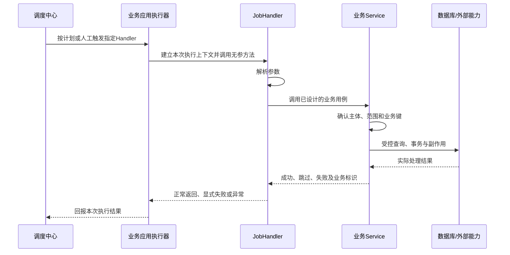

# 任务与调度能力详细说明

**当前源码依据**：`aura-core-common` `dev@53bcd77`；父 POM/BOM 声明 XXL-JOB `3.4.2`，本次核对配置装配和启用注解。既有说明基线为 `4a2a1f1 / 3.4.0`；实际项目需核对解析版本、公开方法及调度中心兼容，本次没有启动或验证 `3.4.2` 调度执行链。

**阅读导航**：先理解[开发原理](#9-开发原理从触发到业务完成)，再按[业务开发路径](#10-实际应用租户日报生成)、[数据与事务](#11-日报示例的数据与事务设计)、[Handler 与业务用例](#12-handler-与-service-怎样协作)实施。只维护本进程状态时读[本地任务示例](#13-本地任务怎样应用)。第 2～8 节用于查依赖、配置和能力边界；研发交付核对[验证方法](#14-开发后怎样验证及交付)。

## 1. 接入场景与业务分工

适合把已有业务用例交给统一调度中心周期触发。AURA 模块负责执行器装配和地址发现；业务项目负责确定任务名称、输入、执行范围及成功判据。批次状态、租户、并发、重试和补偿遵循基础编码规范 `BASE-07/10/11`，不因启用 XXL-JOB 自动形成。

```text
任务名称：设备状态同步
执行范围：指定租户的设备
触发方式：调度中心周期触发
并发策略：同一租户同一批次不并发
失败策略：记录失败项，有限次数重试
成功判据：批次状态完成且失败数可查询
```

## 2. 依赖、启用与执行器配置

业务模块引入与当前 AURA 版本一致的 `aura-common-job`；已经使用 AURA BOM 的项目可由 BOM 管理版本，未使用 BOM 时需显式指定匹配的 AURA 版本：

```xml
<dependency>
    <groupId>net.fxft</groupId>
    <artifactId>aura-common-job</artifactId>
</dependency>
```

应用还须提供可注入的 `DiscoveryClient`，即使已显式配置调度中心地址也是如此，因为当前 `XxlJobSpringExecutor` Bean 方法无条件要求该参数。当前框架以导入 `XxlJobAutoConfiguration` 的方式创建执行器；只引入 Maven 依赖或只写 `xxl.job` 配置，不等于执行器已经创建。应用启动类可采用以下配置方式，实际项目须先编译并验证启动：

```java
import net.fxft.aura.common.job.XxlJobAutoConfiguration;
import org.springframework.context.annotation.Configuration;
import org.springframework.context.annotation.Import;

@Configuration
@Import(XxlJobAutoConfiguration.class)
public class JobConfiguration {
}
```

`aura-common-job` 提供以下配置项：

```yaml
xxl:
  job:
    access-token: ${XXL_JOB_ACCESS_TOKEN:}
    admin:
      addresses: ${XXL_JOB_ADMIN_ADDRESSES:}
    executor:
      appname: ${spring.application.name}
      address: ${XXL_JOB_EXECUTOR_ADDRESS:}
      ip: ${XXL_JOB_EXECUTOR_IP:}
      port: ${XXL_JOB_EXECUTOR_PORT:9099}
      log-path: logs/applogs/xxl-job/jobhandler
      log-retention-days: 30
```

配置要求：

- 令牌从环境或配置中心注入，不进入代码仓库；
- 多实例执行器端口和注册地址必须可区分；
- 容器环境优先使用可达的注册地址，不直接暴露不可访问的容器地址；
- 日志目录具备写权限并设置保留周期；
- 调度中心地址为空时，不得宣称任务已完成注册。
- `admin.addresses` 为空时框架遍历 `DiscoveryClient` 中名称包含 `xxl-job-admin` 的服务，并按 `http://<host>:<port>/xxl-job-admin` 拼接地址；没有发现实例时不能把空值视为有效地址。若调度中心使用 HTTPS、不同上下文路径或地址映射，应显式配置实际可达的 `admin.addresses`，不能依赖该发现规则。
- `executor.appname` 不设时框架回退到 `spring.application.name`；两者都为空不能视为完成自动注册。
- `access-token` 须与调度中心保持一致；配置已读取或执行器 Bean 已创建，并不证明执行器已注册。

当前源码也提供 `@EnableAuraXxlJob`（`net.fxft.aura.common.job.annotation`），其内部导入同一配置；项目沿用已确认的一种启用方式，不重复手工创建执行器。

## 3. 任务实现

任务处理器只负责接收调度参数、校验输入并调用业务 Service，业务逻辑放在可复用的 Service 中。本例使用 Spring Bean 上的无参 `@XxlJob` 方法；注解名必须与调度中心的 JobHandler 配置一致：

```java
import com.xxl.job.core.handler.annotation.XxlJob;
import com.xxl.job.core.context.XxlJobHelper;
import lombok.RequiredArgsConstructor;
import org.springframework.stereotype.Component;
import org.springframework.util.StringUtils;

@Component
@RequiredArgsConstructor
public class DeviceSyncJobHandler {

    private final DeviceSyncService deviceSyncService;

    @XxlJob("deviceSyncJob")
    public void execute() {
        String batchId = XxlJobHelper.getJobParam();
        if (!StringUtils.hasText(batchId)) {
            throw new IllegalArgumentException("缺少批次号");
        }
        // 此示例约定业务失败由 Service 抛出异常，执行线程会将本次调度记为失败。
        deviceSyncService.syncBatch(batchId.trim());
    }
}
```

其中 `DeviceSyncService` 与 `syncBatch` 是业务项目自行实现的用例，不是框架 API。该示例假设业务失败会抛出异常。若业务 Service 返回批次结果而非抛异常，可在处理器中按已确定的成功判据处理；以下 `SyncBatchResult` 及其 `failedCount()` 仅表示业务项目自行定义的结果类型与字段，不是 AURA 或 XXL-JOB API：

```java
SyncBatchResult result = deviceSyncService.syncBatch(batchId.trim());
if (result.failedCount() > 0) {
    // 失败明细保留在业务批次记录中；调度消息只写批次号和数量。
    XxlJobHelper.handleFail("批次 " + batchId + " 存在 " + result.failedCount() + " 条失败记录");
}
```

不能忽略失败结果后正常返回。所用版本的方法任务默认按成功处理；抛出的异常会被执行线程记为失败。调度中心配置 `deviceSyncJob`，传入批次号；调度结果与实际业务批次结果须分别核对。禁止用带参数的普通 `execute(String tenantId)` 方法冒充已注册 JobHandler，也不要在处理器中堆积数据库查询、外部调用和补偿逻辑。

## 4. 租户上下文的接入边界

XXL-JOB 触发参数不是已授权的租户身份；`aura-common-job` 不会自动建立租户上下文。需要按租户执行时，业务 Service 先从可信数据确认执行范围，再在适用的 AURA 租户能力中使用 `TenantBroker.runAs(approvedTenantId, currentTenant -> ...)`，并检查执行后上下文已恢复。系统级任务与跨租户范围由基础编码规范 `BASE-07/10` 决定，本包不另设授权规则。

## 5. 重复触发与业务幂等

调度中心可再次触发同一 JobHandler，但 `aura-common-job` 不提供业务去重、共享锁或断点续跑。业务 Service 按 `BASE-10/11` 确定幂等键、并发边界和恢复方式；执行器配置或单机执行设置不能代替业务幂等结果。

## 6. 事务与外部调用边界

调度器只负责触发处理器，不把业务 Service 的数据库、HTTP、消息和文件操作合并为一个事务。实际任务涉及多系统副作用时，按基础编码规范 `BASE-08/10` 设计一致性及结果确认，不把“调度成功”当成跨系统写入完成。

## 7. 调度结果与业务失败

XXL-JOB 的执行线程会把未抛出异常、未显式标记失败的处理器作为成功结果回传；这个结果只说明本次 Handler 的执行判定，不证明每条业务数据都成功。参数错误、权限错误或业务失败不能捕获后静默返回；部分成功是否算任务成功由业务成功判据决定，若不满足则调用 `XxlJobHelper.handleFail(...)` 或抛出异常，并让批次状态保留可查询的失败项。重试类别、上限和补偿按 `BASE-10` 处理；完整敏感报文不得写入调度日志。

## 8. 完成判断

- 应用已创建 `XxlJobSpringExecutor` Bean，且没有配置或服务发现错误；
- 调度中心能看到可达的执行器注册地址；这与仅创建 Bean 是两种证据；
- 使用与 `@XxlJob` 一致的 JobHandler 触发一次任务，分别核对成功、参数错误和业务部分失败时的调度结果与业务批次结果；注册成功或 Handler 正常返回不等于业务全部成功；
- 任务涉及租户、重复触发、外部副作用或部分成功时，按对应基础规范核对授权范围、幂等、状态和失败结果；这些不是执行器注册的完成条件，也不能由本模块自动保证。

## 9. 开发原理：从触发到业务完成

### 9.1 XXL-JOB 分为三个职责

| 部分 | 实际负责 | 业务开发需要提供 |
| --- | --- | --- |
| 调度中心 | 保存触发计划，按策略向执行器发起调度，接收执行结果 | 执行器选择、Handler 名、触发和失败处理配置 |
| 应用内执行器 | 发现应用的 Handler，接收调度并调用方法，将执行结果回报 | 依赖、启用方式、可达地址、通讯凭据和真实 Handler |
| 业务用例 | 校验参数和执行权限、读取及写入、控制幂等/事务并产生业务结果 | Service、Repository、业务键、范围、结果与验证 |



业务事务和幂等不会因为方法上有 `@XxlJob` 就自动产生。执行器注册、收到调度、方法返回以及业务结果持久化是四个不同环节。把实际处理提交到另一个线程后立即正常返回，会让调度结束先于业务完成；除非有明确的受理及后续回报契约，不采用这种写法。

### 9.2 Scheduled 的不同之处

Spring 在应用进程内注册定时回调，到时间调用 Bean 方法；它不经过 XXL 调度中心。多个实例都启用同一回调时，每个实例都可能执行。`fixedDelay` 以前次完成为间隔起点，`fixedRate` 表达固定节奏，Cron 根据生效时区计算；实际重叠还需结合线程池、多个触发声明和异步调用核对。

因此，仅清理本实例内存缓存可每实例运行；涉及共享业务数据并需要统一管理的任务，优先现有 XXL-JOB，业务仍按已确认方案处理重复与多实例。具体规则见[定时任务与调度规范](../../../01-基础编码规范/10-异步任务消息与外部系统集成规范/03-定时任务与调度.md)。

## 10. 实际应用：租户日报生成

下面采用一项具体业务：**为获准租户的已关闭业务日生成一份日报，失败可以补跑，重复触发不会增加第二份日报。** 这是业务实现示例，表、类和方法名由项目建设，不是 AURA 已提供的日报 API。

### 10.1 先把方案写进模块设计

使用技术详细设计模板第 8.1、8.2 节，在同一份模块设计中明确：

| 设计项 | 本示例选择 |
| --- | --- |
| 触发 | XXL-JOB 每 10 分钟扫描一次；在调度中心明确 `Asia/Shanghai` 的生效配置，不依赖随意的宿主时区 |
| 参数 | 空值表示扫描已登记的待处理窗口；人工补跑传一个 `windowId`，格式为正整数，不接受原始SQL、任意租户或自由日期范围 |
| 业务窗口 | 业务日关闭流程登记租户与业务日；窗口对应 `[该日00:00,次日00:00)`，时区固定。调度仅处理这些已登记窗口，不按每次执行的 now 改换日期 |
| 权限 | 受信系统执行主体读取获准租户集合；创建者只审计；日报机构聚合范围按模块方案确定，本例无机构级授权过滤 |
| 幂等 | 业务键为 `tenantId + businessDate`；调度重试和人工补跑沿用同一窗口 |
| 结果 | 空跑和已完成跳过可成功；本轮任一窗口处理失败则 Handler 报失败，已完成窗口保留 |
| 预算 | 每轮最多处理 20 个窗口；每个窗口只进行本地数据库短事务，无 HTTP、消息或文件副作用；查询和锁等待使用项目明确的超时预算 |
| 漏跑 | 待处理窗口保存在数据库，停机后每轮继续取有界数量，不在启动时无限追赶 |
| 恢复 | 数据事务失败则窗口仍未完成，下次按同一业务键重试；不承诺恢复任意内存闭包 |

这些是本例的方案，不是所有任务的统一参数。若业务日不需要先关闭，项目应另行设计窗口何时完整、迟到数据和重新汇总规则；不能照搬“日历到零点即业务完成”的假设。

### 10.2 工程里放在哪里

```text
业务模块/
  src/main/java/.../dailyreport/
    job/TenantDailyReportHandler.java       调度参数与结果适配
    application/TenantDailyReportService.java  范围与批次编排
    application/DailyReportWindowService.java 单窗口事务
    infrastructure/DailyReportRepository.java 查询、锁定和持久化
  src/main/resources/
    application.yml
    项目既有迁移目录/本次实际增量.sql
  docs/
    本模块技术详细设计.md                   8.1权限、8.2任务方案和实施记录
```

已有业务 Service、Repository 或任务目录时直接复用，不为此图复制一套并行分层。类名可以按项目命名，SQL 仍在数据访问层。Handler 不负责遍历所有数据库表，也不定义新的认证系统。

### 10.3 接上执行器和调度配置

1. 按第 2 节引入真实匹配的 `aura-common-job`，使用已有 `@EnableAuraXxlJob` 或配置导入；已启用就不重复加。
2. 核对 `DiscoveryClient`、执行器 AppName、调度中心地址、通讯 Token 和可达的执行器注册地址。Token 沿用配置中心或环境机制。
3. 在调度中心选择本应用执行器，使用 Bean Handler `tenantDailyReport`，参数默认为空；将触发周期、路由、阻塞、超时和失败重试按设计登记。示例初始不依赖无限自动重试，业务未完成窗口可在后续扫描重新处理。
4. 核对调度中心与执行器所用 Cron 语法和实际时区；确认每 10 分钟的预期触发时刻，再启用。不能只凭某份通用 Cron 示例判断版本兼容。
5. 首次先处理一份隔离窗口；执行器注册、人工触发、业务记录以及回调结果分别查看。

AppName 必须与调度中心登记的执行器一致，Handler 名必须与代码注解一致。路由和单机阻塞策略帮助分配触发，但本例防止重复日报依靠数据库业务键与事务，不依赖“永远只会调用一次”。

本例可使用以下初始配置，在目标版本校验后启用；这些值属于本例，不作为所有任务的默认值：

| 调度项 | 本例填写 | 含义 |
| --- | --- | --- |
| 执行器 | 与 `xxl.job.executor.appname` 一致的已登记执行器 | 选定处理此业务的应用 |
| 运行方式/Handler | Bean / `tenantDailyReport` | 匹配无参方法的 `@XxlJob` 名称 |
| 调度方式/Cron | Cron / `0 0/10 * * * ?` | 每10分钟；须在所用版本预览未来触发时刻并确认时区 |
| 参数 | 正常周期为空；人工指定窗口如 `12345` | 不接受任意 tenantId 或自由SQL |
| 路由/阻塞 | 本例可用轮询＋单机串行 | 每次选择一个执行器实例，同窗口仍由数据库幂等保证 |
| 过期/失败重试 | 本例忽略错过的单次触发；初始自动失败重试为0 | 待处理业务窗口不丢失，由后续有界扫描恢复；不代表忽略业务失败 |
| 超时 | 按20窗口总预算及数据库超时确定后填写 | 不能把“调度中断信号”当作事务和线程已终止 |

## 11. 日报示例的数据与事务设计

### 11.1 用什么数据表达窗口和结果

| 数据 | 本例最小字段与约束 | 用途 |
| --- | --- | --- |
| `daily_report_window` | `id`、`tenant_id`、`business_date`、`status`；`UNIQUE(tenant_id,business_date)`；status 为 PENDING/SUCCESS | 由已确认业务日关闭流程登记，不是调度器创建的随机批次 |
| `daily_report` | `tenant_id`、`business_date`、`total_count`、业务需要的汇总值；同样唯一键 | 一份租户业务日最多一个当前结果 |
| 原始业务数据 | 可信 `tenant_id`、业务发生时间与实际需汇总字段 | 在固定窗口及授权范围内聚合 |

若系统已有结算日、账期或日报表，优先直接复用其键和状态。本例只需本地短事务，不增加租约表或分布式锁。涉及跨系统或长时间计算时，需另设计处理权、持久化进度及副作用确认，不能把本例数据库锁覆盖整个外部调用。

### 11.2 单窗口如何保证一致性

以下为 SQL 逻辑，实际表名、参数类型和方言按项目映射并使用参数绑定：

```sql
-- 事务内按获准租户与窗口编号锁定；业务参数不能扩大租户范围。
SELECT id, business_date, status
FROM daily_report_window
WHERE id = :windowId AND tenant_id = :approvedTenantId
FOR UPDATE;

-- 已为 SUCCESS 则直接返回“已完成跳过”。PENDING 时再读取该租户固定日期窗口。
SELECT COUNT(*) AS total_count
FROM business_record
WHERE tenant_id = :approvedTenantId
  AND occurred_at >= :startTime AND occurred_at < :endTime;

-- 写入唯一日报结果，并在同一事务中更新窗口为 SUCCESS。
-- INSERT/UPSERT 的具体实现依项目数据库，不把此处占位写成可直接执行迁移。
UPDATE daily_report_window
SET status = 'SUCCESS'
WHERE id = :windowId AND tenant_id = :approvedTenantId AND status = 'PENDING';
```

实际处理顺序是“事务开始 → 锁窗口 → 判完成 → 聚合并写日报 → 更新状态且检查影响行数 → 提交”。同一个窗口的并发执行在锁后重新看状态：前一个成功后，后一个跳过；前一个失败回滚后，后一个才按未完成状态处理。结果唯一键再保护数据约束。

聚合失败、日报写入失败或状态更新不符合预期都抛异常回滚，不能先提交 SUCCESS 再生成结果。若结果表已有记录但窗口仍是 PENDING，本例视为一致性异常并查明原因，不静默把它当作另一个新日报。

本例的 PENDING 不表示每次尝试都成功。失败原因在本轮调度与业务日志可定位；需要长期展示每次失败或人工处理时，再复用项目运行记录能力或增加明确的尝试记录。数据库回滚后若要持久记录失败，使用独立短事务等已设计方式，不能假定回滚事务内写的失败状态仍保留。

## 12. Handler 与 Service 怎样协作

### 12.1 Handler 只做参数和结果适配

```java
import com.xxl.job.core.context.XxlJobHelper;
import com.xxl.job.core.handler.annotation.XxlJob;
import lombok.RequiredArgsConstructor;
import org.springframework.stereotype.Component;

@Component
@RequiredArgsConstructor
public class TenantDailyReportHandler {
    private final TenantDailyReportService service;

    @XxlJob("tenantDailyReport")
    public void execute() {
        String raw = XxlJobHelper.getJobParam();
        // null 表示扫描已登记窗口；传值时只允许一个明确的窗口编号。
        Long windowId = raw == null || raw.isBlank() ? null : Long.valueOf(raw.trim());
        if (windowId != null && windowId <= 0) {
            throw new IllegalArgumentException("windowId必须为正整数");
        }
        // 业务返回类型由本模块实现；异常不吞掉，调度端才能收到失败。
        ReportRunResult result = service.runPending(windowId);
        XxlJobHelper.log("日报处理 success={}, skipped={}, failed={}",
                result.successCount(), result.skippedCount(), result.failedCount());
        if (result.failedCount() > 0) {
            XxlJobHelper.handleFail("日报存在失败窗口，数量=" + result.failedCount());
        }
    }
}
```

`ReportRunResult`、`TenantDailyReportService` 都是项目业务类型，不能从 AURA 包里寻找同名 API。参数无法解析、权限异常和未处理系统错误应失败；批次内允许继续其他窗口时，Service 汇总失败，Handler 不能把它们丢掉后返回全成功。

### 12.2 Service 决定范围和调用顺序

下面展示**业务实现契约**，依赖接口需按项目真实来源实现。调用名称表示职责，不宣称框架内置日报、权限目录或任务仓储：

```java
// 示例业务Service的核心顺序，省略构造器与结果累加等普通代码。
public ReportRunResult runPending(Long requestedWindowId) {
    executionPolicy.requireExecutionAllowed();
    // 受信任务配置/服务授权给出的范围；不是从调度参数直接取得tenantId。
    var approvedTenants = executionPolicy.authorizedTenants("tenantDailyReport");
    // 扫描取最多20个PENDING；补跑按范围定位指定窗口，包括已完成的窗口。
    var windows = requestedWindowId == null
            ? repository.findPending(approvedTenants, 20)
            : repository.findRequested(approvedTenants, requestedWindowId);
    // 指定无权或不存在窗口时明确拒绝；扫描空结果则按设计正常空跑。
    executionPolicy.requireRequestedWindowVisible(requestedWindowId, windows);
    return processWindows(windows);
}
```

处理每个窗口前再次确认适用的执行范围。若数据访问需要 AURA 租户上下文，可在已确认租户后使用公开 `TenantBroker.applyAs(approvedTenantId, ...)` 包住本租户业务调用。它只负责切换/恢复上下文，**不替你判断是否有权使用该租户**，也不建立用户认证。需要服务身份的调用继续使用项目已验证的身份适配。

单窗口事务放在独立 Spring Bean 的 `@Transactional` 方法，或项目已有的事务模板里；跨 Bean 调用使声明式事务经过代理，不能在同一个实例里自调用后就假定事务生效。一个窗口失败不回滚前面已提交的其他窗口；逐个计入成功/跳过/失败，并保留业务键和可定位错误。

```java
// 本例拟建业务Bean；Repository各方法对应第11节的参数绑定SQL。
@Service
@RequiredArgsConstructor
public class DailyReportWindowService {
    private final DailyReportRepository repository;
    private final ReportExecutionPolicy executionPolicy;

    @Transactional(rollbackFor = Exception.class)
    public WindowOutcome process(long windowId, long approvedTenantId) {
        executionPolicy.requireTenantAllowed(approvedTenantId);
        var window = repository.lockWindow(windowId, approvedTenantId);
        if (window == null) {
            throw new IllegalArgumentException("窗口不存在或不在允许范围");
        }
        if (window.isSuccess()) {
            return WindowOutcome.SKIPPED;
        }
        // 窗口来自持久业务日，按设计时区解析；范围参数进入Repository。
        var summary = repository.aggregate(approvedTenantId, window.businessDate());
        repository.insertReport(approvedTenantId, window.businessDate(), summary);
        if (repository.markSuccess(windowId, approvedTenantId) != 1) {
            throw new IllegalStateException("窗口状态更新冲突");
        }
        return WindowOutcome.SUCCESS;
    }
}
```

代码中的 `DailyReportRepository`、`ReportExecutionPolicy`、窗口类型与 `WindowOutcome` 都需按本模块真实契约实现；`@Service`、`@Transactional` 等使用对应 Spring 注解。批次 Service 注入该 Bean 后逐窗口调用，在事务代理返回或抛异常之后累加结果；不能在单窗口事务里吞异常并返回成功。系统授权若来自动态服务，还需明确它与在途事务的变更一致性，本例不承诺权限撤销瞬间中止已开始事务。

如果指定了已经成功的窗口，`findRequested` 仍应先在授权范围内查到，再由单窗口事务返回“已完成跳过”；不能复用仅查询 PENDING 的方法而误报无权限。`findPending` 与 `findRequested` 的真实 SQL 都需限制获准租户，空授权集合返回空或拒绝，不能因集合为空就移除租户条件。

### 12.3 失败和重跑怎样工作

| 场景 | 本例预期 |
| --- | --- |
| 扫描没有待处理窗口 | 成功空跑，success=0，不建虚假日报 |
| 重复触发同一成功窗口 | 跳过，结果数量不增加 |
| 数据库异常 | 当前窗口事务回滚，仍可按原窗口重试；本轮计失败 |
| 未获准租户或指定无权窗口 | 拒绝，零写入，不退化为全租户 |
| 处理前20个窗口仍有积压 | 后续周期继续，不能把未处理窗口记作成功 |
| 调度中心停用任务 | 不再安排新周期；已在执行窗口是否完成按停止方案，不撤销已提交日报 |

停止后恢复时继续扫描同一窗口记录，不能重新生成一组随机业务日；超时中断必须检查实际事务与线程是否结束。本例没有对外副作用，扩展为文件上传、消息或远端写入后，要重新补充一致性方案。

## 13. 本地任务怎样应用

**场景**：清理本实例的过期内存索引。每实例维护自己的数据，允许各实例执行，不要求集中补跑。该任务不触碰共享业务表，也不为它增加统一调度或租户管理员身份。

```java
import lombok.RequiredArgsConstructor;
import org.springframework.boot.autoconfigure.condition.ConditionalOnProperty;
import org.springframework.scheduling.annotation.EnableScheduling;
import org.springframework.scheduling.annotation.Scheduled;
import org.springframework.context.annotation.Configuration;
import org.springframework.stereotype.Component;

@Configuration
@EnableScheduling // 项目已启用时复用原配置，不重复声明。
class LocalSchedulingConfiguration { }

@Component
@RequiredArgsConstructor
@ConditionalOnProperty(name = "local-index.cleanup-enabled", havingValue = "true")
class LocalIndexCleanupTask {
    private final LocalIndexService localIndexService; // 本项目已有或拟建实例内业务服务。

    @Scheduled(fixedDelayString = "${local-index.cleanup-delay-ms:60000}")
    public void cleanup() {
        // Service每轮最多清理1000项，线程安全和耗时上限按项目设计实现。
        localIndexService.removeExpired(1000);
    }
}
```

```yaml
local-index:
  cleanup-enabled: true
  cleanup-delay-ms: 60000
```

固定延迟没有业务日时区计算；若改成 Cron，再明确 `zone`。开关在此例用于 Bean 创建，修改配置不等于现有进程立即停止任务；需要动态启停时应采用明确的运行检查或治理方式。清理服务发生异常应由项目调度错误处理与日志观测反映，不能静默吞掉。

## 14. 开发后怎样验证及交付

| 步骤 | 实际操作 | 能证明什么 |
| --- | --- | --- |
| 设计承接 | 从模块 docs 找到有效版本，核对8.1权限与8.2任务方案 | 开发采用了哪项业务策略 |
| 业务自测 | 固定窗口与身份范围，真实数据库验证重复、并发、回滚、无权零写入和积压预算 | 业务实现的正确性，不能替代注册或触发证据 |
| Handler测试 | 验证空参数/指定窗口、非法参数、部分失败到调度结果的映射 | 参数与执行结果适配；普通直接方法调用不等于真实调度回调 |
| 执行器接入 | 在获授权环境确认 Bean、注册地址、Token一致及中心可见 | 执行器已可达，不能单独证明业务完成 |
| 真实触发 | 触发同一个Handler，关联执行日志、业务窗口、结果行和失败回报 | 调度与业务链已连通 |
| 停用恢复 | 观察停止新周期、在途批次与再次启用后的同窗口处理 | 对应停止/恢复方案的实际结果 |

用 AI 开发时，可以直接提出：

> 使用后端开发技能，按本模块技术设计的 M-02、8.1 权限和8.2任务方案实现 tenantDailyReport。先复用现有执行器与数据访问入口；按指定窗口和业务键实现短事务与有界扫描，同步模块文档并完成重复、拒绝、回滚和失败映射自测。真实调度环境未提供时只记录未验证，不自行连接其他环境。

审查时限定同一模块、设计版本与变更文件，沿配置、Handler、Service、SQL/外部副作用和结果取证。只读本次命中的规范和能力章节；实际依赖或执行器未核实时保留缺口，不用示例代码冒充可直接安装的业务工程。

这套流程交付的是“已经明确方案并完成相应代码与验证的业务任务”。规范说明如何做，能力说明给接入方法，技术设计决定本模块细节，开发和审查技能按同一份设计执行；每一步都能从原模块 docs 追溯，无需另造多份任务过程文档。
