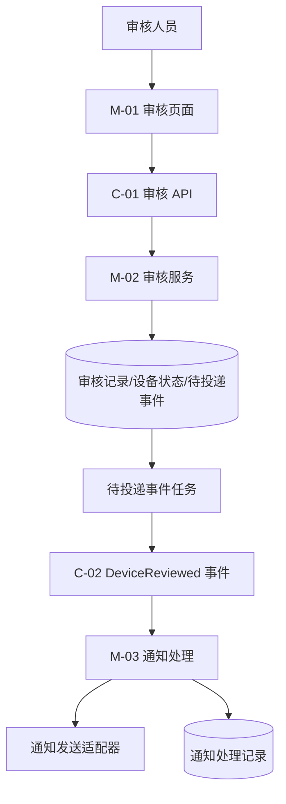
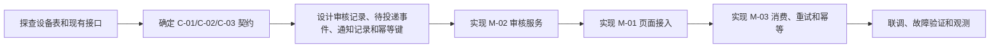
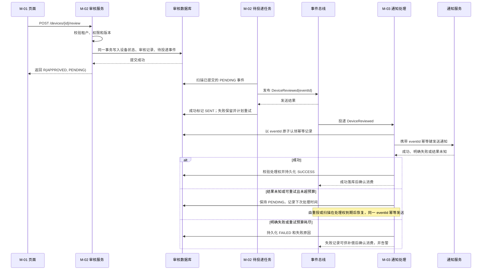

# 技术详细设计文档示例：设备审核并通知

> 本示例按技术详细设计模板的主要章节编排，具体表格按场景展开。业务“审核”只用于说明技术链路，重点是模块、契约、数据、运行时行为和实现顺序。

## 一、文档信息

| 项目 | 内容 |
| --- | --- |
| 设计编号 | DEMO-IOT-DEVICE-REVIEW-001 |
| 设计版本/状态 | 0.1.1-draft / example |
| 所属项目/业务 | 设备管理示例 / 设备审核并通知 |
| 设计负责人 | 示例项目技术负责人 |
| 关联需求或问题 | DEMO-REQ-001：审核完成后通知 |
| 关联架构决策 | 无独立决策记录；本设计第 3 节给出本次方案 |
| 命中的详细设计规则 | AURA-DES-001/002/003/004/005/006/007/008/009/010/011/012 |
| 命中的基础规范/能力包 | BASE-03/05/07/08/09/10/12；通知能力公开契约待确认 |
| 创建日期/最后更新 | 2026-09-18 / 2026-10-21 |

## 二、设计输入与边界

### 2.1 技术目标与验收边界

- 技术要解决的问题：审核结果必须可靠落库，通知失败不能覆盖审核结果。
- 预期技术结果：新增审核提交链路，并在数据库提交后可靠投递通知事件。
- 验收必须证明：审核写入与待投递事件同时落库、通知失败不回滚审核结果、重复投递不产生重复通知。

### 2.2 范围

- 包含：审核页面、审核 API、审核记录、待投递事件、通知消费和失败记录。
- 不包含：通知渠道配置后台、模板管理和设备档案重构。
- 受影响项目和模块：设备管理示例的 M-01/M-02，以及通知示例服务的 M-03；消息通道和通知入口作为待核实的外部依赖。

### 2.3 事实、约束与假设

| 类型 | 内容 | 来源 | 状态 | 影响 |
| --- | --- | --- | --- | --- |
| 事实 | 设备已有待审核状态和设备编号 | 设备表现状 | 已确认 | 复用现有主键 |
| 约束 | 审核权限必须由后端校验 | 权限规范 | 已确认 | 前端只做展示控制 |
| 约束 | 通知失败不能回滚审核状态 | 业务约束 | 已确认 | 审核事务持久化待投递事件，提交后异步发送 |
| 假设 | 消息通道允许至少一次投递，通知发送入口支持以事件编号幂等 | 本示例待核实的接入条件 | 待验证 | 不满足时须调整重试与去重方案，不能承诺不重复通知 |

### 2.4 需求到技术设计的追踪

| 需求/问题 | 技术响应 | 影响模块 | 验证证据 | 状态 |
| --- | --- | --- | --- | --- |
| DEMO-REQ-001 审核成功后通知 | C-01 完成审核；审核事务持久化待投递事件；C-02 异步通知 | M-01/M-02/M-03 | 同事务写入、投递失败补偿和通知消费的验证记录 | 设计已覆盖，接入条件待确认 |
| DEMO-REQ-001 通知失败不回滚审核 | 审核提交后再投递，M-03 独立记录通知结果 | M-02/M-03 | 通知超时下审核状态不变的验证记录 | 设计已覆盖，未执行验证 |
| 重复投递可能造成重复通知 | `eventId` 唯一认领并传给支持幂等键的通知入口 | M-02/M-03 | 重复投递及发送响应丢失场景的验证记录 | 依赖通知入口能力确认 |

## 三、技术设计总览

### 3.1 技术方案结论

| 技术关注点 | 结论 |
| --- | --- |
| 架构形态 | 前后端分离 + 审核事务内写入待投递事件 + 提交后投递 + 异步通知消费 |
| 入口与出口 | 页面调用审核 API；API 返回审核结果；事件驱动通知 |
| 核心组件 | 前端页面、后端应用服务、关系数据库、待投递事件任务、消息处理模块、通知发送适配器 |
| 数据主责 | M-02 拥有审核状态、审核记录和待投递事件；M-03 拥有通知处理记录 |
| 关键风险 | 事件重复、通知超时、审核状态与通知状态不一致 |

### 3.2 技术架构图



### 3.3 技术实现路线图



| 阶段 | 技术目标 | 主要产物 | 进入条件 |
| --- | --- | --- | --- |
| 探查 | 确认已有设备状态、消息和通知入口 | 现有表、接口和公开能力清单 | 事实与假设分开 |
| 契约 | 确定跨模块边界和失败语义 | C-01、C-02、C-03 和状态矩阵 | 通知入口幂等能力已核实或替代方案已确定；查询的原版本关联及未知结果处理已确认 |
| 数据准备 | 建立持久化与去重基础 | 审核记录、待投递事件、通知记录和迁移方案 | 表约束与回滚路径已确定 |
| 核心实现 | 完成同步审核与可靠投递 | M-02 审核事务和待投递事件任务 | 同事务写入可验证 |
| 调用方接入 | 接入审核操作 | M-01 页面与 API 封装 | C-01 契约联通 |
| 异步实现 | 完成通知消费和失败恢复 | M-03 消费、重试和失败记录 | 重复消费与发送结果丢失有处理结论 |
| 交付验证 | 核对端到端结果与恢复边界 | 异常、并发和运行观测证据 | 阻断问题有结论 |

### 3.4 方案决策与取舍

| 决策编号 | 技术问题 | 选择方案 | 可行替代方案 | 不采用原因 | 关联需求/风险 | 状态 |
| --- | --- | --- | --- | --- | --- | --- |
| D-01 | 审核提交与通知投递如何避免跨系统伪原子 | 审核事务内写入待投递事件，提交后由任务投递 | 在审核事务内直接同步调用通知服务 | 外部调用不能与数据库事务原子提交，通知超时会拖长审核请求 | DEMO-REQ-001；通知失败不能回滚审核 | 已确认 |
| D-02 | 重复投递如何避免重复通知 | 以 `eventId` 作为处理记录唯一键和通知幂等键 | 依赖消息通道只投递一次 | 发送成功但确认丢失时仍可能再次投递，通道次数不能作为通知事实 | 重复投递和响应丢失风险 | 待确认通知入口能力 |
| D-03 | 审核并发如何处理 | 拟采用设备状态与版本条件更新，冲突返回业务错误 | 后写覆盖先写 | 会覆盖其他审核人的已确认结果，无法解释并发冲突 | AURA-DES-006；审核结果一致性 | 待业务负责人确认冲突和覆盖规则；相关写入暂不准入 |

上述取舍是本示例的技术推演，不代表 AURA 框架内置了待投递、消息或通知能力；实际项目必须用已核实的公开契约替换示例前提。

## 四、模块拓扑与工程落点

### 4.1 模块清单

| 模块编号 | 模块名称 | 类型 | 所属项目 | 本次职责 | 变更类型 |
| --- | --- | --- | --- | --- | --- |
| M-01 | 设备审核页面 | 前端 | 设备管理示例 | 展示列表、提交审核和反馈 | 新增 |
| M-02 | 设备审核服务 | 后端 | 设备管理示例 | 权限校验、状态写入、待投递事件及投递任务 | 修改 |
| M-03 | 通知处理 | 消息/能力 | 通知示例服务 | 消费事件、发送通知和记录失败 | 修改 |

### 4.2 模块协作矩阵

| 模块 | 输入 | 输出/公开能力 | 数据主责 | 依赖模块 | 被依赖模块 |
| --- | --- | --- | --- | --- | --- |
| M-01 | 用户操作、设备列表 | C-01 调用、页面状态 | 无 | M-02/C-01 | 用户 |
| M-02 | C-01、设备数据 | 审核结果、C-02 | 审核状态、审核记录和待投递事件 | 数据库 | M-01、M-03 |
| M-03 | C-02 | 通知发送、失败记录 | 通知处理记录 | M-02/C-02 | 无 |

### 4.3 工程落点与文件范围

| 模块 | 工程目录和 docs 位置 | 新增 | 修改 | 删除/迁移 |
| --- | --- | --- | --- | --- |
| M-01 | `device-review/pages`、`device-review/api`；模块 `docs/` | 审核页面和请求封装 | 路由和权限展示 | 无 |
| M-02 | `device-review/controller`、`application`、`repository`、`event`；模块 `docs/` | 审核用例、待投递事件任务和事件适配器 | 设备状态、审核记录与待投递事件 | 新增表迁移；不删除旧数据 |
| M-03 | `notification/consumer`、`notification/sender`；模块 `docs/` | 消费处理 | 重试配置和通知记录 | 新增记录表迁移；不删除旧数据 |

> 本示例中的工程目录是用于说明模块边界的逻辑落点，不是 AURA 框架内置目录。实际项目必须替换为真实仓库、模块和 `docs/` 路径，并在设计变更记录中保留替换后的范围。

## 五、契约与数据设计

### 5.1 契约清单

| 契约编号 | 提供方 | 使用方 | 类型 | 输入/载荷 | 输出/结果 | 超时重试 | 失败归属 | 兼容策略 |
| --- | --- | --- | --- | --- | --- | --- | --- | --- |
| C-01 | M-02 | M-01 | HTTP API | 设备编号、审核结果、版本 | 审核结果和状态 | 页面不可盲目重试；服务以状态和版本阻断重复写入 | M-02 判定，M-01 展示 | 增量字段兼容 |
| C-02 | M-02 | M-03 | 事件 | 事件编号、设备编号、审核结果、操作者、租户 | 无同步响应 | 投递任务重试；消费端按事件编号幂等 | M-02 处理投递失败，M-03 处理通知失败 | 保留事件版本 |
| C-03 | M-02 | M-01 | HTTP 查询 | 设备编号、审核请求原版本 | 已确认审核结果或结果仍未知 | 可重复查询；查询未命中不等于原提交未执行 | M-02 提供可见结果，M-01 保留未知状态 | 新增只读查询，复用认证与数据范围 |

### 5.1.1 C-01 审核 API 的具体定义

```http
POST /api/devices/{deviceId}/review
Content-Type: application/json
Authorization: Bearer <token>
TENANT-ID: tenant-demo
```

请求头由 AURA 公共请求层注入；服务端从已验证的认证上下文取得操作者身份，并校验 `TENANT-ID` 是否属于该身份可选范围，再检查审核权限和设备数据范围。请求标识沿公共链路传递并写入日志，不能把租户请求头本身当作授权依据。

请求：

```json
{
  "reviewResult": "APPROVED",
  "reviewRemark": "设备资料完整",
  "version": 3
}
```

成功响应：

```json
{
  "code": 200,
  "msg": "success",
  "data": {
    "deviceId": "D-1001",
    "reviewStatus": "APPROVED",
    "reviewId": "R-20260918-0001",
    "notificationStatus": "PENDING"
  },
  "ok": true
}
```

`notificationStatus=PENDING` 仅表示审核事务已经持久化待投递事件，不表示消息已发送或通知已送达；`ok` 为框架序列化的只读兼容字段，调用方按 `code` 判断结果。

失败结果：

| HTTP/业务结果 | 含义 | 处理 |
| --- | --- | --- |
| `401 / UNAUTHENTICATED` | 令牌缺失或失效 | 进入统一认证处理，不写入审核状态 |
| `403 / REVIEW_FORBIDDEN` | 无设备审核权限或无权选择租户 | 不写入审核状态 |
| `409 / REVIEW_VERSION_CONFLICT` | 设备已被其他人审核 | 刷新最新状态，不盲目重试 |
| `404 / DEVICE_NOT_FOUND` | 设备不存在或不在可见范围 | 页面提示并刷新列表 |
| `500 / REVIEW_PERSIST_FAILED` | 审核事务写入失败 | 状态、记录和待投递事件全部回滚；先查询结果再决定是否重试 |

失败响应示例（HTTP `409`，其余失败同样使用统一 `R<T>` 外壳、稳定业务错误码和请求标识）：

```json
{
  "code": 409,
  "msg": "设备状态已发生变化，请刷新后重试",
  "data": {
    "errorCode": "REVIEW_VERSION_CONFLICT",
    "requestId": "req-20260918-001",
    "retryable": false
  },
  "ok": false
}
```

### 5.1.2 C-02 审核事件的具体定义

事件名称：`DeviceReviewed`

事件版本：`1`

幂等键：`eventId`

```json
{
  "eventId": "EV-20260918-0001",
  "eventType": "DeviceReviewed",
  "eventVersion": 1,
  "tenantId": "tenant-demo",
  "deviceId": "D-1001",
  "reviewId": "R-20260918-0001",
  "reviewResult": "APPROVED",
  "reviewerId": "U-009",
  "reviewedAt": "2026-09-18T10:30:00+08:00"
}
```

投递约束：M-02 的待投递任务只扫描已提交记录，以 `eventId` 向消息通道投递；失败保留记录并重试。消息发送成功而回写状态失败时可能重复投递，不能据发送次数判断通知次数。

消费约束：M-03 以 `eventId` 唯一约束创建处理记录，通过带到期时间的处理权原子认领；已成功则确认消费，未完成则按下文恢复规则使用同一 `eventId` 重试。若通知入口不支持该幂等键，发送成功后响应丢失仍可能重复通知，须先落实替代去重方案。处理权机制由本示例设计，不代表框架或消息通道已内置。

### 5.1.3 C-03 审核结果查询与未知结果处理

本查询是示例拟新增的业务契约，不是已存在的 AURA 接口；真实项目已有等效查询时引用其模块接口文档，不重复开发。示例入口为 `GET /api/devices/{deviceId}/review-result?expectedVersion=3`，请求头、认证和租户/设备可见范围与 C-01 相同，响应使用同一 `R<T>` 外壳。

| 方向/字段 | 类型与约束 | 含义 |
| --- | --- | --- |
| 请求 `deviceId` | string；必填 | 与原提交相同的设备编号 |
| 请求 `expectedVersion` | integer；必填；与 C-01 的 `version` 相同 | 原审核请求使用的版本，不是刷新后生成的新版本 |
| 响应 `data.resultState` | string；`MATCHED` / `CHANGED` / `UNKNOWN` | 同版本且当前操作者的审核已提交、设备已被其他审核改变、尚不能确定原提交结果 |
| 响应 `data.reviewId` | string；`MATCHED` 时提供，其余可空 | 已提交审核记录编号 |
| 响应 `data.reviewStatus` | string；仅在有可见已提交结果时提供，其余可空 | 设备的已确认审核状态，不在查询中改变状态 |

M-02 在已验证租户与设备范围内，将原版本、服务端操作者和已提交审核记录关联；`device_version` 保存原请求版本，并与设备当前状态一起判定结果。`MATCHED` 只确认相同业务审核已提交，不能仅凭设备已进入终态就认定是该操作者提交；匹配不到且不能确定他人已提交时返回 `UNKNOWN`。状态映射与查询一致性仍须在真实项目中核实。

M-01 超时后保留原表单与版本，按项目确认的查询间隔和总等待预算调用 C-03：`MATCHED` 展示已确认结果；`CHANGED` 提示冲突并重新加载；`UNKNOWN` 保持“结果待确认”，预算耗尽后提供查询/联系处理入口，不自动换版本再次提交。单次查询未命中不能排除原请求仍在执行。C-03 的认证、权限、资源不存在和系统错误沿用 C-01 约定，失败也不能解释成原审核未提交。

### 5.2 数据对象与所有权

| 对象 | 类型 | 所属模块 | 来源 | 读写方式 | 是否公开 | 转换位置 |
| --- | --- | --- | --- | --- | --- | --- |
| 审核请求 | 请求模型 | M-01/M-02 | 页面输入 | 读取 | 是 | M-01 API 封装、M-02 Controller |
| 审核结果查询响应 | 响应模型 | M-02 | 已提交审核记录、原版本及当前设备状态 | 只读 | 是 | M-02 查询用例组装 `resultState`、`reviewId` 和 `reviewStatus`，不返回持久化实体 |
| 审核记录 | 持久化模型 | M-02 | 审核 API | 读写 | 否 | M-02 用例与仓储 |
| 待投递事件 | 持久化模型 | M-02 | 审核事务 | 写入/扫描/更新 | 否 | M-02 事件适配器 |
| DeviceReviewed | 事件 | M-02 | 审核记录 | 发布/消费 | 是 | M-02 投递任务构造，M-03 消费端解析 |
| 通知处理记录 | 持久化模型 | M-03 | 事件和发送结果 | 读写 | 否 | M-03 消费用例与仓储 |

### 5.2.1 关键表字段

`device_review_record`（M-02 拥有）：

| 字段 | 类型 | 说明 | 约束 |
| --- | --- | --- | --- |
| `review_id` | varchar(32) | 审核记录编号 | 主键 |
| `tenant_id` | varchar(32) | 经认证上下文确认的租户/数据范围 | 非空；与 `device_id` 组成查询索引 |
| `device_id` | varchar(32) | 设备编号 | 非空；与 `tenant_id` 组成查询索引 |
| `review_result` | varchar(16) | `APPROVED`/`REJECTED` | 非空 |
| `reviewer_id` | varchar(32) | 审核人 | 非空 |
| `device_version` | int | 审核请求携带的原版本，供条件更新和 C-03 结果关联 | 非空 |
| `reviewed_at` | timestamp | 审核时间 | 非空 |

`tenant_id` 由服务端已验证的认证上下文确定并写入审核记录；不能直接信任请求头。M-02 查询、更新和并发版本校验必须同时带上 `tenant_id` 与 `device_id`，避免跨租户读取或更新；事件中的 `tenantId` 从该已确认范围生成。

`device_review_event_outbox`（M-02 拥有，由本示例业务实现，不代表框架已内置）：

| 字段 | 类型 | 说明 | 约束 |
| --- | --- | --- | --- |
| `event_id` | varchar(64) | 事件幂等键 | 主键 |
| `review_id` | varchar(32) | 对应审核记录 | 唯一索引 |
| `event_payload` | text | 含版本号的事件载荷 | 非空 |
| `delivery_status` | varchar(16) | `PENDING`/`SENT` | 非空 |
| `retry_count` | int | 投递尝试次数 | 默认 0 |
| `next_retry_at` | timestamp | 下次投递时间 | 可空 |

`notification_process_record`（M-03 拥有）：

| 字段 | 类型 | 说明 | 约束 |
| --- | --- | --- | --- |
| `event_id` | varchar(64) | 事件幂等键 | 唯一索引 |
| `review_id` | varchar(32) | 审核记录编号 | 索引 |
| `process_status` | varchar(16) | `PENDING`/`SUCCESS`/`FAILED` | 非空 |
| `retry_count` | int | 已重试次数 | 默认 0 |
| `last_error` | varchar(512) | 最近一次失败原因 | 可空 |
| `lease_owner` | varchar(64) | 本次处理权标识 | 认领时写入；状态回写须校验相同标识 |
| `lease_until` | timestamp | 处理权到期时间 | 认领及续期按条件更新；过期后允许重新竞争 |
| `next_retry_at` | timestamp | 下次可恢复处理时间 | 与重试预算共同限制重试；不由重复消息立即无限触发 |

M-03 的恢复顺序：消息到达时创建或查询记录，仅在未完成且处理权为空或到期时原子认领；处理权有效时不并发发送。成功后先以相同处理权标识持久化 `SUCCESS`，再确认消费。认领后崩溃或发送后落库前崩溃，由消息重投或补偿扫描在到期后重新认领，以同一 `eventId` 调用已确认支持幂等的通知入口；旧工作者不得覆盖新工作者状态。可续期处理权不能单独消除超时后并发发送，仍依赖通知入口的幂等保证。

发送结果未知时保持可恢复记录，记录最近错误与下次处理时间，不冒称未发送；超过已确认预算时持久化 `FAILED` 并告警，确认消费的时点必须保证记录已可供人工补偿。处理权时长、续期、扫描频率和重试预算由实际调用超时及容量确定，未确认前阻断 M-03 运行实现。补偿扫描、消息确认方式及下游幂等均是需落实的设计条件，不能仅凭唯一索引认定恢复已经可靠。

### 5.3 一致性与幂等

- M-02 在同一数据库事务内完成审核状态、审核记录和待投递事件写入；任一写入失败时一同回滚。提交后投递任务再发布 C-02；投递失败保留待投递记录并重试，不回滚已确认审核。
- M-02 使用设备状态与版本条件更新防止并发重复审核，并用 `review_id` 唯一关联待投递事件；请求超时后先查询审核结果，不盲目再次写入。
- M-02 的审核记录按已验证的 `tenant_id` 隔离；查询、更新和版本校验均不得只使用 `device_id`。
- M-03 以事件编号作为唯一键原子认领，并向支持幂等键的通知入口传递 `eventId`；已成功处理的事件不再次产生通知。投递与消费均按至少一次处理，不能依赖“只投递一次”。
- 通知失败不修改 M-02 的审核状态，只更新 M-03 的通知处理记录。

## 六、运行时链路与异常行为

### 6.1 主技术链路

| 步骤 | 调用方 | 被调用方 | 方式 | 输入输出 | 数据或事件 |
| --- | --- | --- | --- | --- | --- |
| 1 | M-01 | M-02 | HTTP | 审核请求/审核结果 | 写入审核记录 |
| 2 | M-02 投递任务 | M-03 | 事件 | DeviceReviewed | 待投递事件和通知处理记录 |
| 3 | M-03 | 通知服务 | HTTP/能力调用 | 通知请求/发送结果 | 成功或失败记录 |

### 6.1.1 一次请求的时序



### 6.2 异常、重试与补偿

| 故障场景 | 触发点 | 技术处理 | 最终状态 | 重试/补偿 | 观测证据 |
| --- | --- | --- | --- | --- | --- |
| 无审核权限 | C-01 入站 | 后端直接拒绝 | 审核状态不变 | 不重试 | 授权失败日志 |
| 重复审核 | M-02 条件更新 | 校验版本或状态 | 返回业务冲突 | 不盲目重试 | 冲突记录 |
| 审核事务写入失败 | M-02 数据库提交 | 状态、审核记录及待投递事件一同回滚 | 审核未完成 | 查询结果后再决定重试 | 事务失败日志 |
| 事件投递失败 | M-02 投递任务 | 保留待投递事件并计划重试 | 审核已完成、通知待处理 | 告警并持续补偿 | 待投递数量和最老记录年龄 |
| 发布成功但回写失败 | 消息确认后更新待投递状态 | 保留待投递事件，同一 `eventId` 可能再次投递 | 审核已完成、通知结果由 M-03 判断 | 按事件编号去重 | 重复投递与状态更新失败记录 |
| 通知超时 | M-03 调用通知入口 | 记录失败并以同一 `eventId` 重试 | 审核已完成、通知待处理 | 超过次数进入失败记录 | 重试次数和告警 |
| 重复事件 | M-03 消费 | 原子认领并检查事件幂等键 | 满足通知入口幂等前提时不重复通知 | 不重复创建处理记录 | 幂等命中指标 |

### 6.3 状态转换

| 当前状态 | 触发事件 | 条件 | 下一状态 | 持久化或消息动作 |
| --- | --- | --- | --- | --- |
| 设备 `PENDING_REVIEW` | 审核提交 | 权限、租户、状态和版本通过 | 设备 `APPROVED` 或 `REJECTED` | 同事务写审核记录和待投递事件 `PENDING` |
| 设备 `PENDING_REVIEW` | 审核提交 | 事务写入失败 | 保持 `PENDING_REVIEW` | 审核记录和待投递事件一同回滚 |
| 待投递事件 `PENDING` | 投递任务 | 消息通道确认接收 | `SENT` | 记录发送结果；不代表通知已成功 |
| 待投递事件 `PENDING` | 投递任务 | 发送失败或确认结果不明 | 保持 `PENDING` | 更新重试时间；再次使用同一 `eventId` |
| 通知记录 `PENDING` | 通知发送 | 幂等发送成功 | `SUCCESS` | 记录发送结果 |
| 通知记录 `PENDING` | 通知发送 | 明确不可重试或超过重试上限仍失败 | `FAILED` | 留存失败原因并告警；人工补偿后才重新处理 |
| 通知记录 `PENDING` | 消息重投或补偿扫描 | 原处理权到期且未成功 | 保持 `PENDING` 并取得新处理权 | 同一 `eventId` 恢复；回写校验当前处理权，成功落库后再确认消费 |

## 七、模块技术实现卡片

### 7.1 M-01 设备审核页面

| 项目 | 技术内容 |
| --- | --- |
| 技术目标 | 提交审核并准确展示后端结果 |
| 工程落点 | `device-review/pages`、`device-review/api` |
| 负责链路步骤 | 1 |
| 输入和前置条件 | 已认证用户选择有权审核的设备，填写结果和备注 |
| 输出和契约 | C-01 的审核结果或稳定失败结果；C-03 的查询结果或未知状态 |
| 核心实现方式 | `DeviceReviewPage.vue` 负责组合；`deviceReviewApi.ts` 封装 C-01；提交中锁定按钮并展示真实结果 |
| 数据读写 | 只读列表和页面状态，不拥有审核状态 |
| 依赖与被依赖 | 依赖 M-02/C-01；由审核人员使用 |
| 失败、重试和恢复 | 保留表单与原版本；超时按 C-03 区分已提交、他人变更和未知；未知不自动再提交 |
| 日志、指标和告警 | 沿用公共请求标识；页面异常按项目既有前端观测方式记录 |
| 变更文件/配置 | `pages/DeviceReviewPage.vue`、`api/deviceReviewApi.ts`、`router/device.ts` |
| 本模块验证 | 正常提交、权限不足、重复点击；超时查询匹配、冲突及持续未知 |

### 7.2 M-02 设备审核服务

| 项目 | 技术内容 |
| --- | --- |
| 技术目标 | 原子保存审核结果与待投递事件，提交后可靠发布 C-02 |
| 工程落点 | `device-review/controller`、`application`、`repository`、`event` |
| 负责链路步骤 | 1、投递步骤 2 |
| 输入和前置条件 | C-01 请求；认证、租户、权限、设备状态与版本校验通过 |
| 输出和契约 | C-01 审核结果；C-03 只读查询结果；待投递任务发布 C-02 |
| 核心实现方式 | `DeviceReviewController` 适配 C-01/C-03；`ReviewDeviceUseCase` 完成权限、版本和事务编排；`ReviewResultQuery` 只读组装查询响应；`DeviceReviewRepository` 同事务保存审核状态、审核记录及待投递事件；`DeviceReviewedDeliveryTask` 提交后投递 |
| 数据读写 | 拥有设备审核状态、带 `tenant_id` 的审核记录和待投递事件；租户范围取自已验证认证上下文 |
| 依赖与被依赖 | 依赖设备数据访问和消息通道；被 M-01/C-01、M-03/C-02 依赖 |
| 失败、重试和恢复 | 状态冲突返回业务失败；事务失败全部回滚；投递失败保留待投递记录，不回滚已确认审核 |
| 日志、指标和告警 | 请求标识关联 `reviewId`、`eventId`；观测待投递数量、最老记录年龄和发送失败 |
| 变更文件/配置 | `DeviceReviewController`、`ReviewDeviceUseCase`、`ReviewResultQuery` 及查询响应模型、`DeviceReviewRepository`、`DeviceReviewedDeliveryTask`、`DeviceReviewedPublisher` |
| 本模块验证 | 权限、状态冲突、事务原子性、投递失败补偿和重复投递 |

### 7.3 M-03 通知处理

| 项目 | 技术内容 |
| --- | --- |
| 技术目标 | 重复投递下完成通知，并保留失败与补偿依据 |
| 工程落点 | `notification/consumer`、`notification/sender` |
| 负责链路步骤 | 2、3 |
| 输入和前置条件 | C-02 事件；通知入口的幂等能力待确认 |
| 输出和契约 | 通知发送结果及通知处理记录 |
| 核心实现方式 | `DeviceReviewedConsumer` 消费事件；`NotificationProcessRepository` 以 `eventId` 唯一约束认领记录；`NotificationSender` 使用相同幂等键调用通知入口 |
| 数据读写 | 拥有通知处理记录，不修改设备审核状态 |
| 依赖与被依赖 | 依赖 M-02/C-02 和待确认的通知公开入口；无下游业务模块依赖 |
| 失败、重试和恢复 | 处理权到期后由重投或扫描恢复，同一 `eventId` 幂等发送；带处理权标识回写成功后再确认消费，失败超限持久化并告警；通知入口不支持幂等时先调整方案 |
| 日志、指标和告警 | 记录 `eventId`、重试次数、失败原因和待处理时间；超限告警 |
| 变更文件/配置 | `DeviceReviewedConsumer`、`NotificationProcessRepository`、`NotificationSender`、`application.yml` 重试配置 |
| 本模块验证 | 重复消费、超时、发送成功和最终失败 |

### 7.4 配置、依赖与部署变更

| 变更编号 | 类型 | 所属模块 | 变更内容 | 默认值/环境差异 | 生效或迁移方式 | 回滚方式 | 验证证据 |
| --- | --- | --- | --- | --- | --- | --- | --- |
| CFG-01 | 数据库 | M-02 | 新增审核记录和待投递事件表、唯一约束及索引 | 开发/联调使用独立示例库 | 先执行迁移，再启用审核写入 | 保留旧表，按迁移脚本反向恢复或使用备份恢复 | 迁移日志、表结构和回滚演练记录 |
| CFG-02 | 消息与配置 | M-02/M-03 | 注册 `DeviceReviewed` 事件版本和通知入口地址 | 各环境地址、超时和重试预算不同 | 发布配置后再开启投递任务 | 关闭投递任务并保留待投递记录 | 配置校验、事件版本和任务指标 |
| CFG-03 | 数据库与消费启停 | M-03 | 建立通知处理记录、`event_id` 唯一约束、处理权及恢复扫描字段/索引 | 各环境单独迁移，处理权和重试参数待确认 | 先建立表与约束、部署支持恢复的消费者，再启用订阅和补偿扫描；不得先消费后补表 | 先停止新消费与扫描并等待/核对在途处理，保留已有成功、未知和失败记录；回退版本仍须识别同一幂等键，不直接删表或清记录 | 表结构/索引、迁移日志、消费启停及在途恢复验证；真实脚本与窗口由项目确认 |

## 八、横向技术要求

| 关注项 | 技术设计 | 依据 | 验证 |
| --- | --- | --- | --- |
| 权限与上下文 | 后端校验操作者、租户和设备数据范围 | AURA 接口与权限规范 | 越权和跨租户验证 |
| 性能与容量 | 审核为同步单条操作，通知异步处理；规模和时延阈值待项目确认 | DEMO-REQ-001，尚无容量实测 | 接口延迟、待投递记录和消息堆积检查 |
| 可靠性 | 本示例业务实现待投递任务；按至少一次投递设计，通知入口幂等能力待核实 | 通知失败不回滚审核的业务约束 | 事务回滚、投递失败、重复投递及通知响应丢失验证 |
| 兼容与迁移 | 事件保留版本字段；旧消费者兼容范围待核实 | C-02 契约设计 | 旧事件回放和数据迁移验证 |
| 可观测性 | 审核请求、事件编号、通知记录可串联 | 故障定位需求 | 日志关联、重试指标和告警检查 |

## 九、实施、验证与交付

### 9.1 实施顺序

1. 设计审核记录、待投递事件、通知记录和事件幂等键；
2. 实现 M-02 审核用例、同事务写入及提交后投递任务；
3. 实现 M-01 页面接入；
4. 在通知入口幂等能力确认后实现 M-03 消费、重试和通知记录；
5. 完成联调、故障验证、观测和文档同步。

### 9.2 验证计划

| 场景 | 预期结果 | 验证类型 | 计划保留的证据 |
| --- | --- | --- | --- |
| 正常审核 | 审核和待投递事件同事务写入，页面成功；投递任务随后发布事件 | 契约/联调 | C-01 请求与响应、数据库记录和 C-02 消费记录 |
| 审核事务失败 | 审核状态、审核记录和待投递事件均不落库 | 故障验证 | 事务回滚断言及数据库记录 |
| 事件投递失败 | 审核结果保留，待投递记录可重试 | 故障验证 | 待投递记录、重试指标及最终发送结果 |
| 无权限 | 后端拒绝且状态不变 | 安全验证 | 越权请求、失败响应和状态记录 |
| 通知超时 | 审核保留，通知以同一事件编号重试或进入失败记录 | 故障验证 | 通知处理记录、重试次数和告警 |
| 重复事件与发送响应丢失 | 通知入口支持幂等时不产生重复通知 | 幂等验证 | 重复投递记录、通知入口幂等回执 |
| 审核响应丢失且原请求仍在途 | C-03 未命中保持未知，不换版本重提；可见提交后再显示结果 | 故障/契约验证 | 原版本、查询序列、提交记录和页面状态 |
| 认领后或发送后落库前崩溃 | 处理权过期后可恢复；同一幂等键不重复产生通知；旧工作者不能覆盖新状态 | 恢复验证 | 处理权变更、重投/扫描记录、通知回执及消费确认顺序 |
| 兼容回放 | 旧事件可被正确处理 | 兼容验证 | 旧事件样本与消费结果 |

以上均为设计阶段计划取得的证据，不表示测试或联调已经执行。

### 9.3 联调与交付验证

| 项目 | 设计内容 |
| --- | --- |
| 联调环境与版本 | M-01 前端、M-02 审核服务、M-03 通知处理、示例数据库和事件通道使用同一设计版本；通知入口版本待确认 |
| 参与模块与责任人 | M-01 提供页面与请求证据；M-02 提供审核记录、待投递记录和事件证据；M-03 提供消费、通知和失败记录证据 |
| 前置数据与权限 | 准备一个待审核设备、一个已变更版本设备、可审核账号、无权限账号及对应租户数据；通知入口必须提供测试凭据或替身说明 |
| 联调顺序 | 先验证 C-01 正常和拒绝，再验证事务回滚；随后验证 C-02 投递、重复投递、通知超时和响应丢失；最后验证旧事件兼容和恢复 |
| 必须留存证据 | C-01 请求/响应、数据库事务前后记录、`eventId`、消费记录、通知响应、日志、指标和构建版本 |
| 阻断判定 | 无法确认通知入口幂等、事件版本兼容或数据回滚时，阻断 M-03 和整体交付结论 |
| 退出条件 | 主链路、拒绝、事务回滚、投递失败、重复事件和兼容回放均有对应证据；未完成项已进入风险表并有责任人 |

联调结果必须区分环境阻断、契约不一致、实现缺陷、外部依赖不可用和结果未知，不能以单个接口返回成功代替完整链路结论。

### 9.4 编码准入结论

| 结论 | 选择一项 | 依据 | 未决项/解除条件 | 责任人 | 复核时点 |
| --- | --- | --- | --- | --- | --- |
| 编码准入 | 有条件进入编码 | 仅限示例内已明确的页面展示、只读模型和不产生外部副作用的骨架；真实项目先核实工程落点 | 审核写入/冲突处理须先确认 D-03 与 C-01/C-03；M-02 投递须确认消息契约；M-03 须确认通知对象、公开入口、幂等、处理权与重试恢复参数 | 项目技术负责人、业务负责人、M-02/M-03 与通知能力负责人 | 各相关步骤进入编码前；公开契约或约束变化时重新复核 |

该结论只在示例设定内说明可先实施的具体步骤，不按模块整体放行。它不是对真实项目的编码批准，不代表真实构建、联调或测试已经通过。

### 9.5 风险与人工确认

| 项目 | 影响 | 处理或确认方式 | 责任人 | 状态 |
| --- | --- | --- | --- | --- |
| 通知入口是否支持以 `eventId` 幂等 | 决定重复投递时能否保证不重复通知 | 核对公开契约并验证响应丢失场景；不满足则改去重方案 | 通知能力负责人、M-03 负责人 | 待确认；阻断 M-03 实现结论 |
| 消息通道和旧消费者兼容范围 | 决定投递方式、重试及版本处理 | 核对公开消息契约与旧事件样本 | M-02/M-03 负责人 | 待确认 |
| 通知最大重试次数 | 影响补偿时效 | 确认次数和人工处理方式 | 业务负责人、M-03 负责人 | 待确认 |
| 审核状态版本控制 | 影响并发审核 | 确认冲突提示和覆盖规则 | 业务负责人、M-02 负责人 | 待确认 |
| 查询恢复的真实契约与一致性 | 决定超时后能否区分匹配、他人变更和未知 | 核对原版本与操作者关联、查询可见性及未知处理 | M-01/M-02 负责人 | 待确认；阻断相关提交与恢复实现 |
| 通知对象与处理权恢复参数 | 决定通知内容、身份及崩溃后继续处理 | 核实通知公开入口、接收者来源、幂等与处理权/确认策略，按故障场景验证 | 业务负责人、通知能力及 M-03 负责人 | 待确认；阻断 M-03 运行实现 |

### 9.6 设计变更记录

| 版本 | 日期 | 变更内容 | 原因 | 影响范围 |
| --- | --- | --- | --- | --- |
| 0.1.1-draft | 2026-10-21 | 补充 C-03 查询恢复与通知认领崩溃恢复设计，按步骤限定准入并统一未决状态 | 关闭文本矛盾及失败链路缺口，保留真实项目待核实边界 | M-01/M-02/M-03、C-01/C-02/C-03 |
| 0.1.0-draft | 2026-10-12 | 明确持久化待投递、接口响应及未决接入条件 | 保证示例技术链路前后一致 | M-01/M-02/M-03、C-01/C-02 |

## 十、技术设计完成自检

- [x] 技术目标、范围、架构、模块、契约和数据主责已写明；
- [x] 技术实现路线图与实施顺序一致；
- [x] 关键方案取舍、配置依赖和部署影响已写明；
- [x] 主链路、异常链路、状态与重试方案已写明；
- [x] 每个变更模块都有技术实现卡片；
- [x] 联调环境、顺序、证据和退出条件已写明；
- [x] 验证计划覆盖正常、权限、故障、重复和兼容场景；
- [x] 已给出有条件进入编码的结论及解除条件；
- [ ] 消息与通知入口的公开契约、幂等能力和旧消费者兼容范围尚待核实；
- [ ] 未执行真实构建、联调或故障验证，不能据本示例认定可以上线。
