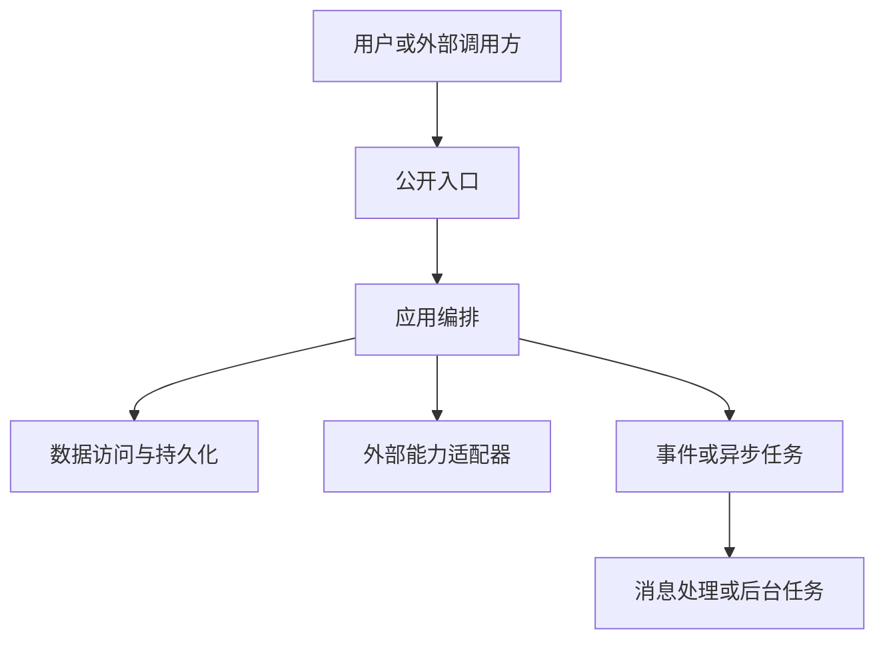

# AURA（天玑）技术详细设计文档模板

> 本模板用于描述“一项业务变更如何被技术实现”。阅读顺序固定为：设计输入 → 技术总览 → 模块与契约 → 运行链路 → 模块实现 → 横向技术约束 → 实施交付。

## 使用说明

- 一项业务只维护一份主技术详细设计；涉及多个项目或模块时，在同一文档中登记并分解。
- 先填写总体技术设计，再填写各模块卡片；不能先分别写模块、最后再猜整体关系。
- 图、表和模块编号必须互相对应，模块使用 `M-01`、`M-02`，契约使用 `C-01`、`C-02`。
- 不适用的技术章节填写“无”并说明原因；未确认内容标记为“假设”或“待确认”。
- 设计中的事实须来自当前项目或公开契约；示意图只是占位结构，不能据此认定项目已具备某种消息、通知或事务能力。

## 设计模式选择

先根据 `AURA-DES-001/002` 选择一种设计模式：

| 模式 | 适用情况 | 产物要求 |
| --- | --- | --- |
| 完整设计 | 影响公开接口、数据模型、状态、权限、跨模块调用、外部能力、异步任务、并发、性能或运行方式 | 按本模板完成适用章节，形成完整技术链路、联调方案和编码准入结论 |
| 简化设计 | 单模块、影响范围明确，且不改变公开契约、数据所有权、状态、权限或运行边界 | 至少填写下方简化设计记录；引用已有设计时写明原设计编号、本次差异和新增验证 |

### 简化设计记录（选择简化设计时填写）

| 项目 | 内容 |
| --- | --- |
| 技术目标与范围 | [本次要解决什么；包含和不包含什么] |
| 受影响模块与文件 | [项目、模块、目录和文件] |
| 事实、约束与假设 | [来源、确认状态和影响] |
| 明确不影响的边界 | [公开接口、数据、状态、权限、外部调用、并发或运行方式；逐项说明] |
| 实现差异 | [现有实现如何调整；如引用已有设计，填写原设计编号和差异] |
| 验证方式与证据 | [正常、边界和回归验证；预期留存证据] |
| 风险与人工确认 | [风险、责任人、解除条件；无则说明依据] |
| 编码准入结论 | [可进入编码 / 有条件进入编码 / 阻断；填写依据和复核时点] |

简化设计记录不能省略关键边界。只写“改页面”“改字段”或几行调用流程，不能作为编码依据。

## 一、文档信息

| 项目 | 内容 |
| --- | --- |
| 设计编号 | [项目编号-领域-序号] |
| 设计版本/状态 | 0.1.0-draft / draft |
| 所属项目/业务 | [填写] |
| 设计负责人 | [填写] |
| 关联需求或问题 | [编号和链接] |
| 关联架构决策 | [编号和链接；无则写“无”] |
| 命中的详细设计规则 | [AURA-DES-编号；按实际触发项填写] |
| 命中的基础规范/能力包 | [BASE-编号、能力包编号或“无”；只列实际命中的公开内容] |
| 创建日期/最后更新 | [填写] |

## 二、设计输入与边界

### 2.1 技术目标与验收边界

- 技术要解决的问题：[填写]
- 预期技术结果：[填写]
- 验收必须证明：[填写]

### 2.2 范围

- 本次包含：[填写]
- 本次不包含：[填写]
- 受影响项目、服务、页面、任务或能力：[填写]

### 2.3 事实、约束与假设

| 类型 | 内容 | 来源 | 状态 | 影响 |
| --- | --- | --- | --- | --- |
| 事实 | [代码、接口、数据或运行事实] | [路径/探针/契约] | 已确认 | [影响] |
| 约束 | [框架、兼容、部署或业务约束] | [规范/需求/能力说明] | 已确认 | [影响] |
| 假设 | [暂未验证的前提] | [来源] | 待验证 | [影响] |

### 2.4 需求到技术设计的追踪

| 需求/问题 | 技术响应 | 影响模块 | 验证证据 | 状态 |
| --- | --- | --- | --- | --- |
| [编号] | [技术方案] | [M-编号] | [测试/联调/探针] | 待确认/已覆盖 |

## 三、技术设计总览

### 3.1 技术方案结论

| 技术关注点 | 结论 |
| --- | --- |
| 架构形态 | [前后端分离/服务协作/异步事件/批处理/其他] |
| 入口与出口 | [请求、事件、任务和最终结果] |
| 核心组件 | [框架、数据库、消息、缓存、文件、能力服务] |
| 数据主责 | [模块与数据对象] |
| 关键风险 | [性能、并发、一致性、兼容、可用性] |

### 3.2 技术架构图

### 3.3 技术实现路线图

| 阶段 | 技术目标 | 主要产物 | 进入条件 | 完成/出口条件 |
| --- | --- | --- | --- | --- |
| 1 现状探查 | 固定代码、数据、接口和运行事实 | 现状清单 | 事实、约束、假设已区分 | 关键事实有来源，未知项进入待确认表 |
| 2 架构与契约 | 固定模块边界、接口、事件和数据模型 | 架构图、契约表、模型 | 关键边界已确认 | 模块、契约和数据主责可以评审 |
| 3 基础准备 | 完成迁移、配置、依赖和消息准备 | 脚本、配置、依赖清单 | 基础环境可支撑实现 | 配置、依赖、迁移和回滚入口已具备 |
| 4 核心实现 | 完成服务、数据访问和能力适配 | 核心代码 | 主技术链路可运行 | 核心链路可在目标环境执行 |
| 5 调用方接入 | 完成页面、任务或其他调用方 | 接入代码 | 契约联通 | 调用方能按契约处理成功、失败和未知结果 |
| 6 故障验证 | 验证失败、重试、幂等、兼容和恢复 | 测试及运行证据 | 阻断问题有结论 | 未决风险已关闭、接受或升级处理 |
| 7 发布观测 | 明确发布、回滚和观测指标 | 发布说明、指标和告警 | 运行风险可接受 | 形成交付结论和后续观测责任 |

### 3.4 方案决策与取舍

| 决策编号 | 技术问题 | 选择方案 | 可行替代方案 | 不采用原因 | 关联需求/风险 | 状态 |
| --- | --- | --- | --- | --- | --- | --- |
| D-01 | [需要裁决的技术问题] | [本次采用方案] | [至少一个可行替代；无则说明] | [成本、兼容、风险或证据原因] | [需求/风险编号] | 已确认/待确认 |

影响架构、数据一致性、外部调用、并发、性能或恢复的决策不得只写最终结论；若方案仍待确认，应同步写入风险与人工确认表。

## 四、模块拓扑与工程落点

### 4.1 模块清单

| 模块编号 | 模块名称 | 类型 | 所属项目 | 本次职责 | 变更类型 |
| --- | --- | --- | --- | --- | --- |
| M-01 | [填写] | 前端/后端/公共/消息/能力/任务 | [项目] | [职责] | 新增/修改/不变 |
| M-02 | [填写] | 前端/后端/公共/消息/能力/任务 | [项目] | [职责] | 新增/修改/不变 |
| M-03 | [需要时增加] | [类型] | [项目] | [职责] | [类型] |

### 4.2 模块协作矩阵

| 模块 | 输入 | 输出/公开能力 | 数据主责 | 依赖模块 | 被依赖模块 |
| --- | --- | --- | --- | --- | --- |
| M-01 | [填写] | [填写] | [数据/无] | [编号] | [编号] |
| M-02 | [填写] | [填写] | [数据/无] | [编号] | [编号] |

### 4.3 工程落点与文件范围

| 模块 | 工程目录和 docs 位置 | 新增 | 修改 | 删除/迁移 |
| --- | --- | --- | --- | --- |
| M-01 | [项目/模块/目录] | [路径] | [路径] | [路径/无] |
| M-02 | [项目/模块/目录] | [路径] | [路径] | [路径/无] |

## 五、契约与数据设计

### 5.1 契约清单

| 契约编号 | 提供方 | 使用方 | 类型 | 输入/载荷 | 输出/结果 | 超时重试 | 失败归属 | 兼容策略 |
| --- | --- | --- | --- | --- | --- | --- | --- | --- |
| C-01 | [M-编号] | [M-编号] | API/事件/任务/文件 | [填写] | [填写] | [填写] | [模块] | [填写] |

### 5.1.1 契约详情或专项文档引用（每个 C-编号按需复制）

| 项目 | 技术定义 |
| --- | --- |
| 契约编号与公开入口 | [C-编号；方法与路径、事件名与版本，或能力包公开入口] |
| 调用方与身份上下文 | [调用方、认证来源、租户选择及权限校验位置；不适用则说明] |
| 请求/载荷与成功结果 | [字段、类型、必填性、空值；接口文档链接或本节完整示例] |
| 失败结果 | [HTTP 状态或事件失败语义、稳定错误码、请求标识、是否可重试及最终归属] |
| 超时、重复与兼容 | [超时边界、幂等键或去重方式、版本与旧调用方影响] |

已有模块接口文档时引用具体章节，不在详细设计中复制一份独立维护的完整接口清单；但影响技术方案的身份、失败、重试和兼容决策仍须在此可见。接口的响应外壳和请求头遵循接口规范，不能用示意裸 JSON 代替实际契约。

### 5.2 数据对象与所有权

| 对象 | 类型 | 所属模块 | 来源 | 读写方式 | 是否公开 | 转换位置 |
| --- | --- | --- | --- | --- | --- | --- |
| [对象] | 请求/响应/领域/持久化/事件/外部 | [M-编号] | [来源] | [读/写] | 是/否 | [模块] |

### 5.3 字段、一致性与幂等

涉及“数据库提交后再调用消息或外部服务”等跨边界副作用时，写明提交与发送之间如何可靠交接、失败后从哪里恢复、重复发送如何去重，以及无法保证的边界。可选事务消息、持久待投递记录或已验证的等效机制；不能把普通数据库事务写成可同时原子提交外部调用，也不能把某一种示例方案当作框架内置能力。

| 字段/规则 | 技术定义 | 空值/默认值 | 一致性要求 | 幂等或并发策略 | 验证方式 |
| --- | --- | --- | --- | --- | --- |
| [填写] | [类型、精度、索引等] | [填写] | [填写] | [填写] | [填写] |

## 六、运行时链路与异常行为

### 6.1 主技术链路

| 步骤 | 调用方 | 被调用方 | 协议/方式 | 输入输出 | 数据或事件 |
| --- | --- | --- | --- | --- | --- |
| 1 | [M-编号] | [M-编号] | HTTP/事件/任务/其他 | [填写] | [填写] |

### 6.2 异常、重试与补偿

逐项覆盖写入失败、提交后发送失败、发送成功但确认结果丢失、重复投递和消费失败等适用场景；若某项不适用，说明原因。重试必须与数据所有权、幂等能力及最终状态一致。

| 故障场景 | 触发点 | 技术处理 | 最终状态 | 重试/补偿 | 观测证据 |
| --- | --- | --- | --- | --- | --- |
| [超时/重复/不可用/数据冲突] | [步骤] | [处理] | [状态] | [策略] | [日志/指标/记录] |

### 6.3 状态转换

| 当前状态 | 触发事件 | 条件 | 下一状态 | 持久化或消息动作 |
| --- | --- | --- | --- | --- |
| [状态] | [事件] | [条件] | [状态] | [动作] |

## 七、模块技术实现卡片

> 每个发生代码、配置、数据或部署变更的模块必须有一张卡片。下面预置两张；更多模块继续复制第二张并递增编号。

### 7.1 模块卡片：M-01 [模块名称]

| 项目 | 技术内容 |
| --- | --- |
| 技术目标 | [填写] |
| 工程落点 | [项目/模块/目录/docs] |
| 负责链路步骤 | [步骤编号] |
| 输入和前置条件 | [填写] |
| 输出和契约 | [C-编号] |
| 核心实现方式 | [类、组件、任务、适配器或配置如何协作] |
| 数据读写 | [对象、表、缓存或文件] |
| 依赖与被依赖 | [模块和契约] |
| 失败、重试和恢复 | [填写] |
| 日志、指标和告警 | [填写] |
| 变更文件/配置 | [填写] |
| 本模块验证 | [填写] |

### 7.2 模块卡片：M-02 [模块名称]

| 项目 | 技术内容 |
| --- | --- |
| 技术目标 | [填写] |
| 工程落点 | [项目/模块/目录/docs] |
| 负责链路步骤 | [步骤编号] |
| 输入和前置条件 | [填写] |
| 输出和契约 | [C-编号] |
| 核心实现方式 | [类、组件、任务、适配器或配置如何协作] |
| 数据读写 | [对象、表、缓存或文件] |
| 依赖与被依赖 | [模块和契约] |
| 失败、重试和恢复 | [填写] |
| 日志、指标和告警 | [填写] |
| 变更文件/配置 | [填写] |
| 本模块验证 | [填写] |

### 7.3 配置、依赖与部署变更

| 变更编号 | 类型 | 所属模块 | 变更内容 | 默认值/环境差异 | 生效或迁移方式 | 回滚方式 | 验证证据 |
| --- | --- | --- | --- | --- | --- | --- | --- |
| CFG-01 | 依赖/配置/数据库/消息/部署 | [M-编号] | [填写] | [填写] | [启动、迁移、灰度或发布步骤] | [回滚或恢复方式] | [构建、启动、迁移或运行证据] |

## 八、横向技术要求

| 关注项 | 技术设计 | 依据 | 验证 |
| --- | --- | --- | --- |
| 权限与上下文 | [身份、租户、数据范围、Trace] | [来源] | [验证] |
| 性能与容量 | [规模、并发、延迟、批量] | [依据] | [压测/探针] |
| 可靠性 | [超时、重试、降级、恢复] | [依据] | [故障验证] |
| 兼容与迁移 | [旧接口、旧数据、灰度、回滚] | [依据] | [联调/发布] |
| 可观测性 | [日志、指标、链路、告警] | [依据] | [运行检查] |

## 九、实施、验证与交付

### 9.1 实施顺序

1. [基础设施、数据和配置]
2. [服务、数据访问和能力适配]
3. [前端、任务或其他调用方]
4. [联调、迁移、验证和文档同步]

### 9.2 验证计划

| 场景 | 预期结果 | 验证类型 | 证据 |
| --- | --- | --- | --- |
| 正常链路 | [结果] | 单元/契约/联调 | [证据] |
| 失败与超时 | [结果] | 异常/故障验证 | [证据] |
| 权限和数据范围 | [结果] | 安全验证 | [证据] |
| 重试、幂等和并发 | [结果] | 测试/压测 | [证据] |
| 兼容、迁移和回滚 | [结果] | 发布验证 | [证据] |

### 9.3 联调与交付验证

| 项目 | 设计内容 |
| --- | --- |
| 联调环境与版本 | [前端、后端、依赖服务、数据库、消息和配置版本] |
| 参与模块与责任人 | [M-编号、提供方、调用方、问题归属人] |
| 前置数据与权限 | [测试数据、租户/组织、账号、能力开通和初始化脚本] |
| 联调顺序 | [按契约、主链路、失败链路和恢复链路排列] |
| 必须留存证据 | [请求/响应、消息、数据库、日志、指标和版本信息] |
| 阻断判定 | [哪些失败会阻止进入下一阶段] |
| 退出条件 | [各模块完成什么结果后认为联调完成] |

联调方案必须区分“环境未准备”“契约不一致”“实现缺陷”“外部依赖不可用”和“结果未知”；不能以接口返回 `200` 或单次页面操作代替端到端结论。

### 9.4 编码准入结论

| 结论 | 选择一项 | 依据 | 未决项/解除条件 | 责任人 | 复核时点 |
| --- | --- | --- | --- | --- | --- |
| 编码准入 | 可进入编码 / 有条件进入编码 / 阻断 | [已确认的事实、契约和验证] | [无；或列出具体未决项与解除条件] | [角色/姓名] | [日期/事件] |

没有填写本节，文档只能作为设计草稿，不能作为编码开始依据。

### 9.5 风险与人工确认

| 项目 | 影响 | 处理或确认方式 | 责任人 | 状态 |
| --- | --- | --- | --- | --- |
| [风险/未决问题] | [影响] | [措施或决策] | [角色] | 待确认/已关闭 |

### 9.6 设计变更记录

| 版本 | 日期 | 变更内容 | 原因 | 影响范围 |
| --- | --- | --- | --- | --- |
| 0.1.0-draft | [日期] | 初稿 | [原因] | [范围] |

## 十、技术设计完成自检

- [ ] 技术目标、范围和验收边界明确；
- [ ] 技术架构图、实现路线图和模块编号一致；
- [ ] 模块协作、工程落点和契约责任明确；
- [ ] 数据对象、所有权、一致性和幂等明确；
- [ ] 主技术链路、异常链路和状态转换完整；
- [ ] 每个发生变更的模块都有技术实现卡片；
- [ ] 方案取舍、配置依赖、部署影响和回滚方式已说明；
- [ ] 权限、性能、可靠性、兼容和可观测性已说明；
- [ ] 联调前置条件、实施顺序、验证证据、风险和人工确认项已列出；
- [ ] 已给出“可进入编码 / 有条件进入编码 / 阻断”的明确结论；
- [ ] 开发者无需重新猜测关键技术方案即可开始实施。
