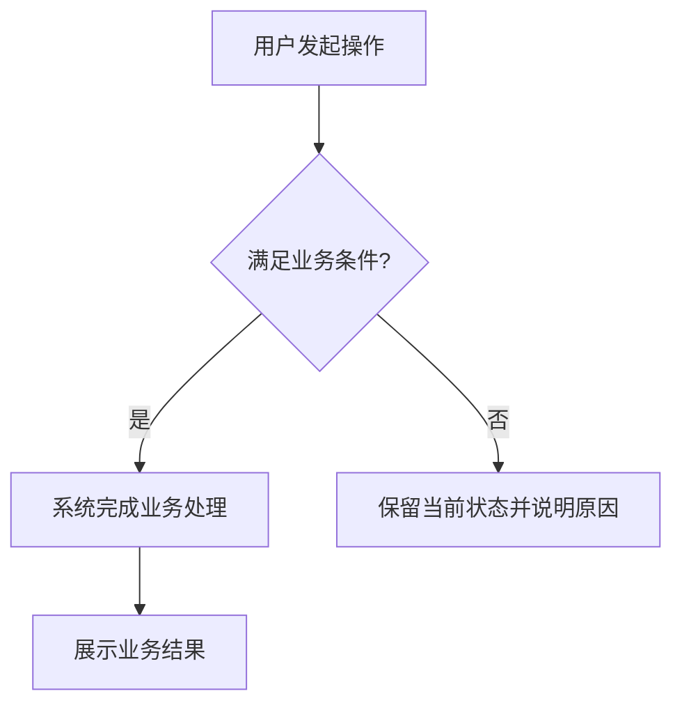

# 开发闭环与业务说明

适用于新开发、修改既有业务及指定旧代码的注释/逻辑梳理。以下可读性与交付要求来自[本地变更记录](readability-source.json)，属于技能补充要求，不是新增 FE 正式规则。

## 1. 先按任务分流

用户任务优先。新开发/功能修改执行后续功能闭环；纯注释/业务说明整理使用以下快速路径，在第 2 节完成说明后即可交付，不进入第 3～5 节。

- 只改注释与说明，保持现有签名、可执行代码、模板属性和行为，不借整理修改组件、import、状态、接口、控制流、依赖或配置。用户已要求保持功能时不重复询问授权；阅读时遇到既有功能偏差可简要记录，不自动整改、不阻断其余整理。
- 阅读实际源码与真实契约，按[注释规范](code-comment-guidelines.md)补齐授权范围的全部注释：每个声明字段自己的相邻中文、方法契约、模板业务语义及真实执行阶段均不减。人工沿源码确认含义与差异仅含注释/文档；无需建立逐对象机器结果矩阵、源码快照、哈希或证据套件。
- 按适用项目约定对本次文件格式化并做最小差异核对。默认不调用 `aura-web-review`，不运行 `check-api-comments.cjs`、FE 规则扫描、ESLint、typecheck、build、测试、浏览器验收或 AST 对比，不生成检查包、自检通过结论或整理审阅报告。
- 用户要求业务说明时按第 2 节维护对应场景说明，按实际独立流程决定是否补图和阅读入口，不因未跑检查阻断。最终简报修改范围、说明位置及未执行自动检查即可。
- 仅用户明确要求结构检查、自检、测试或审阅报告，或有真实来源的项目强制门禁时，按要求范围追加验证。需要开发自检时再加载 `aura-web-review`（本轮 `0.4.2`）；只查注释不机械引入全项目 27 条 FE 门槛。不能把本技能旧版的强制检查当成项目门禁。完整规范审查按用户要求保留其范围；旧功能偏差不构成功能修改授权。

### 结构任务覆盖与收尾

用户要求优化、梳理或重构某个页面/业务模块的结构时，按用户给出的完整范围执行本节；只修字段、局部 Bug 或纯注释不因此触发整模块结构整改。本节落实职责规范的执行覆盖，不新增行数门槛。

1. **先确定完整任务范围**：从实际入口及其私有组件/TS 出发，识别授权范围内已有的业务职责、状态/资源所有者与依赖方向。用户指定整个模块时，不把任务自行缩成最先发现的两三个函数或文件；必要共享依赖只作上下文，不扩大到全项目。已有有效阅读直接复用。
2. **逐职责作处理决定**：按[职责决策表](../knowledge/PIGX前端开发规范/文件组织与职责拆分.md)判断保留、拆组件、抽 Hook/纯函数或提升共用范围。特别核对入口是否仍承载多套可独立描述的请求、状态与生命周期。长但内聚的实现可以保留；已存在可独立管理的混杂职责，不能只以“本轮先做少量”“避免风险”为由忽略，应实施行为保持的拆分，或列出实际契约/环境阻断及未完成范围。
3. **按边界实施而非搬运**：状态、操作与清理各有明确归属，入口保留布局及跨职责协调。不得把剩余整段脚本塞入一个巨型 Hook、传整页 state，或只为降低行数拆碎文件。若委派子任务，主执行者仍负责完整授权范围与跨块衔接，子任务完成不能替代整个任务完成。
4. **完成后复看剩余职责**：回到入口、相关私有文件和新模块，逐项核对未迁移部分是否仍混杂独立职责、是否新产生反向依赖/重复状态/生命周期泄露。保留原文件的部分须能说明其内聚性与归属；尚未检查、尚未拆完或有真实阻断时，只能交付部分完成及具体缺口，不能宣称整模块已优化完成。

在已有任务或开发记录中简记“职责 → 当前所有者 → 保留/调整及依据”即可，不要求独立报告、固定章节、逐函数矩阵、全仓扫描或重复读取。结构判断覆盖完整授权范围，lint/测试/build 仍按实际改动集中执行，不能每提取一个 Hook 就重跑整套。首次整体判断后，只复核发生变化或仍有疑点的边界。

### 检查选择表

本表是功能开发检查触发、范围和时机的唯一节奏来源，其它清单和专项资料只补充命中项的判定要求。常规采用“实现时按需快速反馈 → 本次功能/交付批次稳定后一次必要验收 → 修复后只复查受影响项”。小步编辑、单文件、业务子块或代理完成均不自动触发整套检查；用户要求独立分批交付时才按批次验收。保留规范和注释完整性要求，检查按本次 diff 与必要受影响上下文选择：

| 检查 | 触发与范围 | 执行时机 |
| --- | --- | --- |
| 格式化与差异 | 项目本地 Prettier 仅处理本次修改的受支持文件；遵守项目配置，再核对 Prettier 检查与 `git diff --check` | 准备验收前集中一批；适用强制规则照做 |
| 规则扫描 | 常规以 `-Files` 指定新增/改动业务源码及必要受影响文件，保留 `-StrictUiContracts`；全量仅项目明确门禁、框架公共配置/依赖或真实跨模块影响需要时 | 本批稳定后一次；扫描候选按上下文判定 |
| lint | 项目可用 ESLint 只读检查变更的受支持文件；不使用 `--fix` 或带全仓修复的 `lint:eslint`。明确全量门禁仍执行 | 本批稳定后一次；与规则扫描重复问题合并，旧无关问题记录，不扩大修复 |
| 类型检查 | TS、API、Props 或状态逻辑变更，使用项目已有的类型检查；不以臆造的单文件 `tsc` 代替项目配置 | 最终一次；若核对真实 `package.json` 确认本批必需 build 已包含 `vue-tsc` 等同范围/配置检查，直接复用，不先完整 typecheck 再 build |
| 生产构建 | 新增完整页面、路由或公开入口，动态 import/remote/expose，共享公共代码，依赖/锁文件/构建/资源配置变更，或明确要求生产验收/项目门禁 | 本批最终一次；组合命令含类型检查时只运行一次，不默认连跑多个构建模式。普通已有页面局部业务/API 改动无这些触发且类型、定向检查与核心功能验收覆盖时默认不跑，交付说明原因 |
| 语义自检 | 复用开发已读源码/规范与有效证据，聚焦本批 diff 及必要上下文，一次核对需求、适用规范与完整注释；仅记录命中规则和未决问题 | 稳定后调用 development-self-check；不重新全文扫项目、重复追完整链，不强制新代理、27 条 FE 全矩阵或逐对象 JSON/hash/快照套件 |
| AST/转译一致性 | 只在明确要求行为保持的重构、用户要求验证纯注释行为保持或诊断执行变化时选择 | 正常新增/修改功能不使用代码身份一致性作门禁 |
| 测试与浏览器 | 按变更覆盖核心成功及相关失败/取消/权限边界；选用已有相关测试，复杂新逻辑按风险增加，不为低影响或镜像实现补测试；纯 API 不强制浏览器 | 稳定后一次集中走查，修后只复查受影响路径；不每个组件/保存就开浏览器或每步截屏，必要状态读取遵守工具规则 |

互不依赖的只读检查可并行；类型检查与构建避免重复调用同工具或争抢生成物。格式化完成后再进行相应验收；若之后又有修改，按真实影响补跑必要检查，不反复全套 format/test。已有通过结果仅在其覆盖的源码、配置、依赖与环境均未改变且仍覆盖本批时复用；后续仅注释/文档变更不重跑无关业务检查，旧结果不得覆盖新逻辑。

### 验证产物收尾

功能开发构建默认执行项目既有命令（例如 `pnpm build`），沿用其配置的输出目录（通常为 `dist`）；不要为例行验证自行追加 `--outDir` 或创建 `.codex-*-build`。只有用户明确要求隔离，或确认存在需要保护的产物/并发使用冲突时才采用独立输出，并说明理由。默认 `dist` 属于项目约定产物，不因本节临时清理规则自动删除。

本次验证专用的临时构建目录、隔离配置和中间文件，在必要产物检查/preview 完成且无后续用途后清理，不把 `.codex-*-build` 等验证目录留在业务项目。保留必要的脱敏结论、命令及失败诊断；已有记录足以复核时不另存整套产物。清理前确认精确绝对路径、本次创建归属、无正在使用的进程、无需要保留的源码/交付文件，且路径未通过链接越界；只删明确临时目标，禁止按通配符批量删除或清理项目根/用户已有 dist。用户要求保留、正式交付产物或仍需 preview 时不删，说明用途；权限阻止时记录残留位置与原因，不绕过限制。清理不触发重复构建。

规则扫描只传新增/修改且仍存在的受支持源码；删除文件单独检查 diff、引用与受影响调用链，不传已删除路径。没有适用源码时记录不适用或等本批稳定。显式空 `-Files`、文件缺失、不可读或范围无效均为不完整，不回退全量；只有省略 `-Files` 才全量扫描。`-Files` 支持项目内相对路径与绝对路径；以下在 PowerShell 中直接调用脚本并传真实数组，路径替换为实际存在文件：

```powershell
$projectPath = '<项目绝对路径>'
$changedFiles = @('src/views/<实际页面>.vue', 'src/api/<实际接口>.ts')
if ($changedFiles.Count -eq 0) { throw '没有适用源码，请先确认扫描范围' }
foreach ($file in $changedFiles) {
  if (-not (Test-Path -LiteralPath (Join-Path $projectPath $file) -PathType Leaf)) {
    throw "待扫描文件不存在：$file"
  }
}
& '<本技能绝对路径>/scripts/check-project-rules.ps1' -ProjectPath $projectPath -Files $changedFiles -StrictUiContracts
```

`-Files` 约束检查对象；严格 UI 扫描另读 `src` 中 `zh-cn.ts` / `en.ts` 及 `src/api` 类型作为必要上下文，不把它们当作额外待整改对象。随包 `scripts/check-ui-contracts.cjs` 使用项目已安装 TypeScript 与 Vue compiler 静态建索引、复用路径查询，不执行业务语言模块、不自动安装依赖、不跟随整个依赖图。i18n 只核对定义路径，不证明运行注册、合并覆盖或远端语言加载；动态或无法解析的部分保留待核对。字典同名字段只有绑定真实声明且明确用于展示时才判确定错误，其余候选人工追踪用途，不能仅凭字段同名要求整改。

退出 `0` 仅表示本次可扫描项无确定错误和未决候选，不代表语义/项目合规通过；`1` 有确定错误；`2` 输入、依赖、读取或静态能力不完整/有待人工核对候选（可能同时存在确定错误）。逐项核实待核对项并在开发记录保留依据，不反复重跑相同静态扫描期待清零，也不为满足扫描器改业务。确需修复时修改后仅复查受影响项。直接中文、placeholder、i18n 与字典消费仍遵守原规范；选择表不覆盖项目强制门禁、用户明确检查范围、MF 冷启动或公共包消费等真实触发验证。

正式检查清单中的“发布检查”用于实际发布验收，不自动成为每次局部功能开发的全量安装、构建和扫描门槛；本次用户授权的日常执行节奏按上表选择，正式规范的实现要求继续遵守。涉及生产交付或明确要求发布检查时，按其真实范围执行，不以局部验证冒充发布通过。

### 功能开发闭环准备

以下准备及第 3～5 节适用于功能开发；明确要求验证的整理任务只采用所请求范围。

按业务操作理解实现范围，例如注册、编辑、关联对象；这些子块不是重复验收或报告单元。默认按本次功能/交付批次集中验收，不按文件、函数或代理拆门禁。修改既有业务覆盖本次相关的完整业务块、字段和必要调用链，不扩展无关模块。

开始前记录需求/原型、实际代码范围、Git 提交和未提交状态（无 Git 时记录文件摘要）、技能精确路径与版本，按检查选择表确定必需检查。项目强制门禁须有真实来源；沿用任务已有记录，不另造同内容文件。

API/类型注释覆盖按[声明字段完整性门槛](code-comment-guidelines.md#声明字段完整性门槛)人工沿真实声明核对。只读检查器仅在用户明确要求结构检查或真实项目门禁时运行，例行语义自检不自动触发，结构结果不能代替中文业务语义判定。

## 2. 补齐注释与模块说明

从完整授权业务块的实际源码盘点，按[注释规范覆盖表](code-comment-guidelines.md#业务对象覆盖表)逐项补齐并人工核对中文含义、相邻位置及真实语义；API/类型文件另按[声明字段门槛](code-comment-guidelines.md#声明字段完整性门槛)覆盖完整授权文件，每声明字段有自己的相邻中文。方法、变量、模板及组件实例的格式与细则只在注释规范维护，不以零散注释或截图替代完整覆盖。自检轻量记录命中项与缺口，不强制逐对象机器矩阵；无法确认的业务含义记具体待核实，不编造。

优先遵循项目既有业务文档目录；用户明确要求中文命名时，迁移本次涉及的业务说明并修正链接。没有既定目录时默认：

```text
docs/业务说明/<中文模块>/业务总览.md
docs/业务说明/<中文模块>/<中文功能>.md
```

命名只约束生成的业务说明，项目源码、接口字段和 SDK 知识库 README 保持真实英文标识，不据此改名。上列是需要新建文档时的可选组织方式，不是每次变更的文件清单。局部增字段、校验或沿现有模式调整，优先更新既有功能说明对应段落；没有新增独立业务流程时不机械创建总览、功能单页、新图或目录索引。完整新模块的总览仅写用途、功能关系、必要整体图、阅读入口和共享规则，局部细节放对应功能页，不按开发批次散落。

### 按业务场景组织功能说明

围绕读者实际要完成的业务场景组织正文，每个场景就近说明入口、操作、适用条件、状态变化及成功/失败后的可见结果和下一步。共享规则只写一次并引用；没有的分支不虚构。以下是可裁剪的示例结构，标题、顺序与表格按实际阅读需要调整，不要求固定六段、操作表或独立字段章节。

````markdown
# <中文功能名>

<简述业务目标、参与者和场景关系。>

## <实际业务场景，如发起申请>

<从哪里进入、如何操作、哪些条件下可用；结合操作解释必要业务字段、校验和状态变化，以及成功、失败或取消后用户看到什么、可以做什么。>

## <另一个独立场景，按需保留>

<就近说明本场景的条件、操作与结果；共用规则引用前文，避免重复。>

## 业务流转图



图按真实实现改写，突出主路径和关键分支，不画几十个底层函数调用。真实复杂协作或状态转移才另补必要时序/状态图。

## 代码阅读入口

| 项目相对路径 | 本功能职责 |
| --- | --- |
| <真实文件路径> | <支撑哪一步业务> |
````

业务字段按需融入场景操作或规则，必要时用小表解释有依据的业务含义、编码、单位、约束及空值。正文内容以是否帮助理解业务选择、操作条件、状态变化或可见结果取舍；仅说明实现方式的配置值、保护计时和计算公式留在源码，避免把字段表改写成逐项技术段落。类型、协议及字段全量映射引用现有类型或接口文档；内部状态、计算和组件配置由相邻源码注释承载，不另建重复技术字段文档。取消业务字段表不减少源码注释覆盖：仍按注释规范逐对象核验实际消费字段（含嵌套字段）与声明的用途、约束和状态语义。

新建独立业务流程或实质改变主路径/关键分支时，维护按真实实现绘制的业务流转图，放在能帮助理解场景的位置；现有图仍准确时复用，无独立新流程的局部变更不另画图。代码阅读入口复用已有真实路径与职责，新增或变化时再更新，可用列表或小表；支持时使用按文档实际位置解析的相对链接并核对，不要求方法行号。内部类型或函数调用清单不能充当业务正文；已有正文、图、表单用途及代码实际行为须一致。

执行自检时，字典接入记录、已知缺陷、失败测试和整改历史写入轻量开发检查记录，不单独生成 business/dictionary-integration 等业务说明；业务正文仅保留影响当前使用的必要说明，与业务有关的字典取值约束就近并入场景规则并引用依据。

## 3. 确认并调用开发自检

功能开发涉及表单时，自检输入和已有开发记录须包含 [useForm 验收](../recipes/hooks-standards.md#编码与验收)的表单范围及实际调用位置；按适用生命周期核对 FE-013/019，不能只凭 `useForm` 导入判通过。只检查本次授权业务块和必要调用方，纯注释快速路径保持不变。

本节及后续检查、整改与报告只适用于功能开发或明确要求验证的整理任务；普通纯整理已在快速路径完成。

调用前读取实际将使用的 `aura-web-review/SKILL.md`、`VERSION` 及其模式资料，确认明确支持 `development-self-check`（本次仓库版本为 `0.3.0`）。记录真实路径和版本，不能仅凭技能名或可用列表认定支持；即使审查技能支持单报告 `change-review`，开发闭环仍明确调用自检模式。

已安装旧版缺失模式时如实说明能力缺口；若当前仓库中的新版可读取，可明确以其绝对路径加载 SKILL.md 和引用资料，记录“仓库路径调用，未安装替换”。例如本仓库相邻入口 `skills/aura-web-review/SKILL.md`，运行时解析实际仓库绝对路径，不硬编码维护者路径。新版不可取得时该检查阻断，继续独立工作；不自动安装、不假称调用成功、不改走六文件正式流程。

交给自检的任务输入应包含：

```text
使用 <实际绝对路径>/aura-web-review/SKILL.md，mode=development-self-check。
项目=<绝对路径>；业务块=<范围与必要调用链>；任务类型=<新开发/功能修改或纯注释/说明整理>；需求/原型=<位置>；
代码基线=<提交、工作区状态或摘要>；业务说明=<路径>；
必需检查=<项目门禁及本次检查/测试计划>；检查记录=<实际位置>。
```

这是技能语义模式，不是 `Review-Frontend.ps1` 的命令参数，也不要求新建代理。自检复用同一 Agent 已读且未变的源码、规范和证据，按本批 diff 与必要上下文选读同版 `rules.json`、命中正文和可读性要求，集中完成一次语义检查；不重复追已确认链路，不机械枚举 27 条规则。用户明确完整规范审查时仍覆盖其要求；扫描仅辅助。审查技能只读业务代码，返回问题和证据，本技能只承担本次用户授权范围内的修复；纯整理只改注释/文档，既有功能偏差只记录。同一 Agent 执行须写明“开发自检”，不宣称独立审查。

完整规范审查与功能开发自检均将 AuraDictTag / AuraDictText / AuraDictSelect 的公开接入与筛选/表单/展示消费纳入 FE-025，并关联 FE-019；其余 aura-ui 仍在审查范围外。开发侧既有 aura-ui 选型及使用检查继续执行，分别记录范围和来源。

## 4. 检查记录、整改与复查

自检不创建六文件或专用审查结果包；优先在任务已有记录保留范围/版本/工作区状态、需求依据、命中规则及来源、结论与证据、问题及关闭条件、修复与复查、实际命令/工作目录/工具版本/退出码、未执行原因和剩余阻断。局部功能可直接以同一份简短开发记录承载检查与最终交付，无约定可用 `docs/development-checks/<任务>/开发记录.md`；完整新功能或要求独立报告时保留过程记录供报告引用。不把空模板当完成记录，也不重复复制已有效保存的证据。

注释验收仍按第 2 节链接的覆盖表与声明字段门槛逐项核对真实语义、相邻说明及位置，缺项记需整改；轻量记录问题，回改后重查受影响对象与链路，不以注释数量、仅 warning 或结构扫描清零判通过。

新开发/功能修改按用户授权修改代码、注释或说明，再检查受影响部分，直到本次适用必需检查和测试通过。纯整理仅整改注释/文档缺陷并核对行为保持，既有 FE 功能偏差保留“原有偏差—本次未修改—建议”记录，不能借“直到全部通过”扩大授权。保留失败、修复与复查历史；改动使已有证据失效时重新获取，不能把旧结果搬成新通过。不得降低断言、跳过检查或缩小既定验收范围制造通过。“不适用”要有事实依据；未执行、失败、环境不可用或证据不足都不能记通过。

缺环境、材料、授权或关键业务决定时，在同一记录写阻断和待补条件，继续能独立完成的工作；不写最终通过结论或已完成报告。用户询问进度时如实反馈，不把进度当交付完成。

## 5. 通过后供开发人员审阅

仅用户明确要求整理审阅报告时，在所请求检查完成后生成“注释/说明整理审阅报告”，明确仅该范围通过、既有 FE 功能偏差与建议，不宣称整体 FE 合规或功能缺陷已关闭。用户明确要求全规范通过而有未解决功能偏差时，该合规结论仍阻断，并列具体需授权事项；整理成果仍可如实交付。

功能开发全部适用必需项通过后标记“自检通过，待人工审查”，不要替人工写“审核通过”。按交付规模选择记录形式：

- **局部功能变更**：用第 4 节同一份简短开发记录合并检查与交付，写清需求、本次修改、业务说明位置、实际证据、问题关闭情况、未执行/不适用原因及版本范围，不再机械创建独立开发报告或过程文件。
- **完整新功能或用户要求独立报告**：保留开发报告及过程记录，在项目既有目录或 `docs/development-reviews/<任务>/` 生成本次交付批次的一份 `<中文功能名>-开发审阅报告.md`，引用已有检查记录，不重复证据。明确要求整理报告时默认 `注释说明整理审阅报告.md`，仅陈述实际检查范围与结果。

独立报告包含：

1. 结论、业务目标与本次变更，以及供人工重点审阅的实现和业务取舍；结论限定于本次任务范围。
2. 代码阅读入口及职责、对应模块/功能说明与流转图链接，可列阅读顺序；不复制业务正文，不要求方法位置或行号。
3. 验证摘要、非阻断限制与检查记录入口；详细规则、问题整改、失败和复查证据留在检查记录。仅扫描通过不算语义自检通过，Mock 不能称真实后端通过。
4. 版本范围与证据：需求依据、被审真实提交/工作区状态或文件摘要、技能路径/版本、检查时间及证据链接，使结论可复核。

业务说明长期解释当前业务；开发记录保存本次检查、失败、整改与交付结论；确需独立报告时只摘要结论和变更并链接过程证据。不为本轮任务无故新增目录索引或迁移全部历史文件。

交付与复查节奏按检查选择表，不为业务子块或代理分别造报告。整体完成核对受影响的跨块衔接，更新必要说明与同一记录/报告摘要；注明有效范围、复用依据、未执行/不适用原因与当前或历史状态。旧记录保留原范围及证据并链接后续结果，不把旧通过冒充新逻辑通过。
