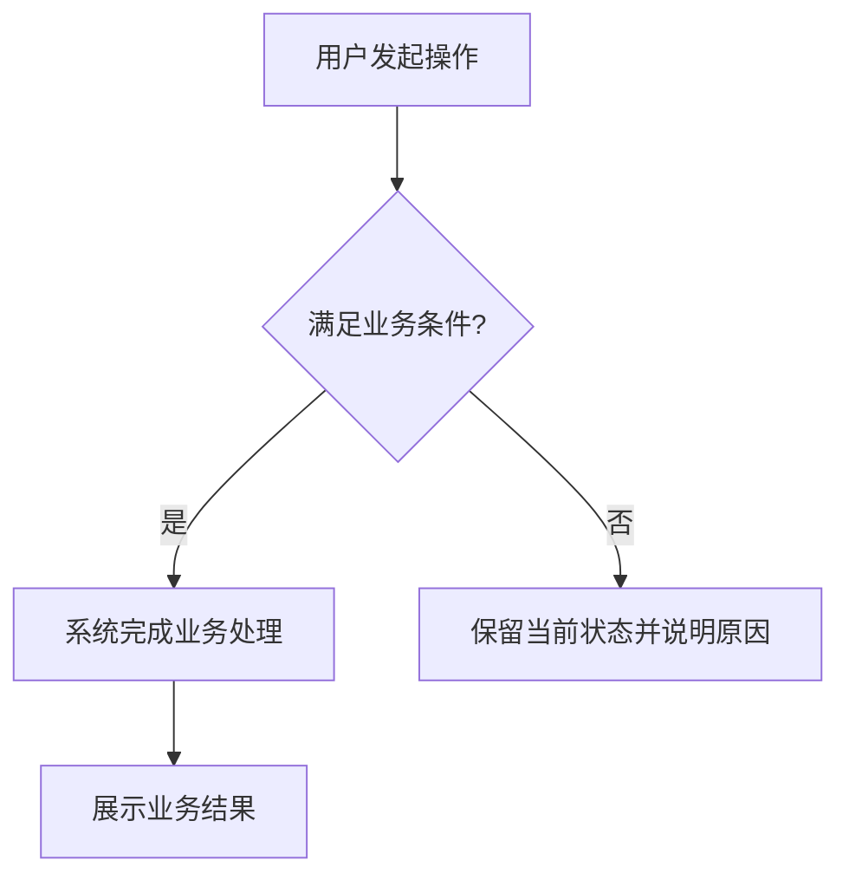

# 开发闭环与业务说明

适用于新开发、修改既有业务及指定旧代码的注释/逻辑梳理。以下可读性与交付要求来自[本地变更记录](readability-source.json)，属于技能补充要求，不是新增 FE 正式规则。

## 1. 确定业务块与检查门槛

用户任务优先，先区分“新开发/功能修改”与“纯注释/业务说明整理”。纯整理只允许修改注释和说明文档，保持可执行代码与行为；不得修改 DOM 属性、组件、import、状态、接口、控制流、依赖或配置，包括不得借规范整改增加重试、useForm、竞态处理或替换字典组件。发现既有 FE 功能偏差仅记录原有问题、证据和建议，不自动修复，也不因此停止其余可读性整理；无需逐项反复询问授权。新开发/功能修改在用户原授权内整改。

纯整理以本次 READ 可读性与行为保持为必需门槛：核对差异仅含注释/文档且未改变运行逻辑；项目格式化按授权范围约束，不得让格式化顺带产生可执行代码或模板属性调整。既有功能 FE 偏差保留规则原结论，但属于原有问题记录，不加入本次自动整改范围。若用户明确要求整体全规范通过，功能偏差阻断该目标，列明需追加授权的具体修改；仍继续已授权注释工作。

按可独立理解和验收的业务操作或闭环划分，例如注册、编辑、关联对象，不按文件数或函数数拆分。修改既有业务覆盖本次相关的完整业务块、字段和必要调用链，不扩展无关模块。仅解释旧实现时保持行为，不因补说明自动重构。

开始前记录需求/原型、实际代码范围、Git 提交和未提交状态（无 Git 时记录文件摘要）、技能精确路径与版本。按任务影响和项目要求确定必需检查：需求一致性、注释及业务说明、适用工程/接口/权限/状态/异常规范、项目本地格式化、静态与类型检查、相关测试，以及适用的构建和页面交互验收。项目强制门禁不能省略；每块不必重复整套验证，整体门禁在相应阶段完成。

## 2. 补齐注释与模块说明

先按[注释规范覆盖表](code-comment-guidelines.md#业务对象覆盖表)阅读实际源码，列出本次业务变量/服务、模板区块和语义元素、业务组件实例、事件/生命周期与关键逻辑对象；实施及自检共用“对象—用途/状态—注释位置—结论”记录，所有纳入对象漏项均需整改，不靠截图或零散注释通过。方法与字段按该规范执行。方法 JSDoc 用途与标签分行、空行分隔，简短字段/Props/Emits 默认同行尾部 //；复杂约束或 IDE 文档可用上方独立 JSDoc，块与声明不挤同行，字段和事件签名不按方法强制标签。沿关键方法实际顺序逐阶段补齐业务步骤、条件、数据映射、异步恢复和状态副作用的相邻中文行注释，写清做什么、为何及不满足结果，不以总注释代替。模板写具体表单用途，每个国际化表单/筛选字段及业务表格列有中文业务含义，主要操作分组和状态区有真实说明；不要求普通布局或相同按钮文案机械重复。逐项补齐业务变量、组件 ref、loading/ready 和默认业务常量及业务局部变量用途，短声明尾 //，复杂状态说明取值、更新时机及影响；模板注释位于所属 FormItem/表格列/筛选语义所有者正上方，不藏内部 span/t()。业务含义来自需求、源码与真实契约；无法确认则记待核实，不编造。

优先遵循项目既有业务文档目录；用户明确要求中文命名时，迁移本次涉及的业务说明并修正链接。没有既定目录时默认：

```text
docs/业务说明/<中文模块>/业务总览.md
docs/业务说明/<中文模块>/<中文功能>.md
```

命名只约束生成的业务说明，项目源码、接口字段和 SDK 知识库 README 保持真实英文标识，不据此改名。总览仅写模块用途、功能关系及整体业务图、功能阅读索引和共享规则；局部功能细节放对应单页。没有新的独立业务流程时在现有页内分节，不机械拆多页、不按开发批次散落、不创建空文档。

### 按业务场景组织功能说明

围绕读者实际要完成的业务场景组织正文，每个场景就近说明入口、操作、适用条件、状态变化及成功/失败后的可见结果和下一步。共享规则只写一次并引用；没有的分支不虚构。以下是可裁剪的示例结构，标题、顺序与表格按实际阅读需要调整，不要求固定六段、操作表或独立字段章节。

````markdown
# <中文功能名>

<简述业务目标、参与者和场景关系。>

## <实际业务场景，如发起申请>

<从哪里进入、如何操作、哪些条件下可用；结合操作解释必要业务字段、校验和状态变化，以及成功、失败或取消后用户看到什么、可以做什么。>

## <另一个独立场景，按需保留>

<就近说明本场景的条件、操作与结果；共用规则引用前文，避免重复。>

## 业务流转图



图按真实实现改写，突出主路径和关键分支，不画几十个底层函数调用。真实复杂协作或状态转移才另补必要时序/状态图。

## 代码阅读入口

| 项目相对路径 | 本功能职责 |
| --- | --- |
| <真实文件路径> | <支撑哪一步业务> |
````

业务字段按需融入场景操作或规则，必要时用小表解释有依据的业务含义、编码、单位、约束及空值。正文内容以是否帮助理解业务选择、操作条件、状态变化或可见结果取舍；仅说明实现方式的配置值、保护计时和计算公式留在源码，避免把字段表改写成逐项技术段落。类型、协议及字段全量映射引用现有类型或接口文档；内部状态、计算和组件配置由相邻源码注释承载，不另建重复技术字段文档。取消业务字段表不减少源码注释覆盖：仍按注释规范逐对象核验实际消费字段（含嵌套字段）与声明的用途、约束和状态语义。

保留按真实实现绘制的业务流转图，突出主路径与关键分支，放在能帮助理解场景的位置。代码阅读入口简洁列出相关页面、组件、Composable、API、类型或 Store 的真实路径和职责，可用列表或小表；支持时使用按文档实际位置解析的相对链接并核对，不要求方法行号。内部类型或函数调用清单不能充当业务正文；正文、图、表单用途及代码实际行为须一致。

字典接入记录、已知缺陷、失败测试和整改历史写入轻量开发检查记录，不单独生成 business/dictionary-integration 等业务说明；业务正文仅保留影响当前使用的必要说明，与业务有关的字典取值约束就近并入场景规则并引用依据。

## 3. 确认并调用开发自检

调用前读取实际将使用的 `aura-web-review/SKILL.md`、`VERSION` 及其模式资料，确认明确支持 `development-self-check`（本次仓库版本为 `0.2.2`）。记录真实路径和版本，不能仅凭技能名或可用列表认定支持。

已安装旧版缺失模式时如实说明能力缺口；若当前仓库中的新版可读取，可明确以其绝对路径加载 SKILL.md 和引用资料，记录“仓库路径调用，未安装替换”。例如本仓库相邻入口 `skills/aura-web-review/SKILL.md`，运行时解析实际仓库绝对路径，不硬编码维护者路径。新版不可取得时该检查阻断，继续独立工作；不自动安装、不假称调用成功、不改走六文件正式流程。

交给自检的任务输入应包含：

```text
使用 <实际绝对路径>/aura-web-review/SKILL.md，mode=development-self-check。
项目=<绝对路径>；业务块=<范围与必要调用链>；任务类型=<新开发/功能修改或纯注释/说明整理>；需求/原型=<位置>；
代码基线=<提交、工作区状态或摘要>；业务说明=<路径>；
必需检查=<项目门禁及本次检查/测试计划>；检查记录=<实际位置>。
```

这是技能语义模式，不是 `Review-Frontend.ps1` 的命令参数，也不要求新建代理。自检读取同版 `rules.json`、适用规则正文与补充可读性要求，依靠阅读代码、追踪调用链和技术判定；扫描仅辅助。审查技能只读业务代码，返回问题和证据，本技能只承担本次用户授权范围内的修复；纯整理只改注释/文档，既有功能偏差只记录。同一 Agent 执行须写明“开发自检”，不宣称独立审查。

两种审查模式均将 AuraDictTag / AuraDictText / AuraDictSelect 的公开接入与筛选/表单/展示消费纳入 FE-025，并关联 FE-019；其余 aura-ui 仍在审查范围外。开发侧既有 aura-ui 选型及使用检查继续执行，分别记录范围和来源。

## 4. 检查记录、整改与复查

自检不创建六文件或专用审查结果包；在任务已有证据目录保留一份轻量检查记录，无约定时可用 `docs/development-checks/<任务>/<业务块>.md`。记录实际范围/版本/工作区状态、规则 ID 与来源、纳入对象、结论及证据位置、问题与关闭条件、修复位置和复查结果、准确测试命令/工作目录/工具版本/退出码、剩余阻断。路径以实际项目为准，不把空模板当完成记录。

注释验收沿实际源码逐项记录“对象/步骤 → 业务语义 → 相邻说明及位置 → 是否准确”；业务组件实例须核对组件类型、当前业务职责、关键配置/输入、组件引用、事件绑定与显示条件及已有生命周期边界，模板含返回标题说明、操作、业务内容及表单等区块与元素；例如既有提交方法先识别校验、载荷转换、请求、恢复与成功副作用各阶段，再逐项核对，而不是预设固定阶段或只统计注释。缺方法分行、模板字段中文说明或业务步骤解释均记需整改，回改后重查受影响链，不能仅 warning 或凭结构扫描清零判通过。

新开发/功能修改按用户授权修改代码、注释或说明，再检查受影响部分，直到本次适用必需检查和测试通过。纯整理仅整改注释/文档缺陷并核对行为保持，既有 FE 功能偏差保留“原有偏差—本次未修改—建议”记录，不能借“直到全部通过”扩大授权。保留失败、修复与复查历史；改动使已有证据失效时重新获取，不能把旧结果搬成新通过。不得降低断言、跳过检查或缩小既定验收范围制造通过。“不适用”要有事实依据；未执行、失败、环境不可用或证据不足都不能记通过。

缺环境、材料、授权或关键业务决定时提供阻断说明和待补条件，继续能独立完成的工作；不生成该业务块的最终开发审查报告。全部通过前只保留过程记录、问题和阻断说明。用户询问进度时如实反馈，不把进度当交付完成。

## 5. 通过后供开发人员审阅

纯整理的可读性与行为保持检查通过后可生成“注释/说明整理审阅报告”，明确仅该范围通过、既有 FE 功能偏差与建议，不宣称整体 FE 合规或功能缺陷已关闭。用户明确要求全规范通过而有未解决功能偏差时，该合规结论仍阻断，并列具体需授权事项；整理成果仍可如实交付。

新开发/功能修改全部适用必需项通过后才在项目既有目录，或 `docs/development-reviews/<任务>/` 生成每块报告，文件名默认 `<中文功能名>-开发审阅报告.md`；纯整理默认 `注释说明整理审阅报告.md`。沿用既有报告目录，不为业务说明中文化强制迁移过程记录目录；默认状态“自检通过，待人工审查”。不要替人工写“审核通过”。报告包含：

1. 结论、业务目标与本次变更，以及供人工重点审阅的实现和业务取舍；结论限定于本次任务范围。
2. 代码阅读入口及职责、对应模块/功能说明与流转图链接，可列阅读顺序；不复制业务正文，不要求方法位置或行号。
3. 验证摘要、非阻断限制与检查记录入口；详细规则、问题整改、失败和复查证据留在检查记录。仅扫描通过不算语义自检通过，Mock 不能称真实后端通过。
4. 版本范围与证据：需求依据、被审真实提交/工作区状态或文件摘要、技能路径/版本、检查时间及证据链接，使结论可复核。

业务说明长期解释当前业务；development-reviews 供人工阅读本次结论与变更；development-checks 保存检查、失败、整改和复查证据，不相互复制。不为本轮任务无故新增目录索引或迁移全部历史文件。

每块通过后交付并继续已授权工作，不等待逐块批准。整体完成时按任务类型核对跨块衔接，纯整理验证说明一致与行为保持、原有功能偏差只记录；功能任务执行整体必需门禁，更新模块总览并生成整体报告概览。报告明确标识当前有效、受后续变更影响待复查或历史记录。后续修改影响已完成块时更新说明、重取受影响证据；旧报告保留原范围、版本、结论和证据，注明已成为历史并链接后续检查/报告，不能让旧快照显示为当前通过。新结论仅依据复查后的实际证据。
